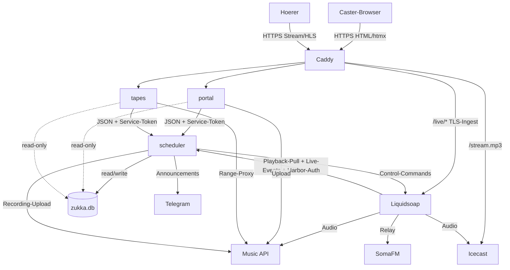

# Konsolidierte Architektur — radio zukka v2

Dieses Dokument ist die **Source of Truth für Entscheidungen**. Die Einzel-Dokumente
(`architecture.md`, `data-model.md`, `liquidsoap.md`, `portal.md`,
`infrastructure.md`, `tapes.md`) bleiben als Detail-Referenz bestehen, sind aber
diesem Dokument untergeordnet. Wo sie abweichen, gilt hier.

Stand: 2026-11-18, Branch `v2`. Grundlage: Audit der fünf Workstream-Dokumente
plus die acht verbindlichen Betreiber-Prinzipien.

---

## 1. Prinzipien

| #   | Prinzip                                    | Technische Konsequenz in diesem Dokument                                                                                                                                                                      |
| --- | ------------------------------------------ | ------------------------------------------------------------------------------------------------------------------------------------------------------------------------------------------------------------- |
| P1  | **Weniger moving Parts**                   | 6 Container, 1 DB, 1 Migrations-Owner, 2 Service-Tokens, 6 Volumes. Kein Sidecar, kein Cache-Volume, kein zweiter Auth-Pfad.                                                                                  |
| P2  | **EINE DB** für Scheduler + Portal + Tapes | `zukka.db`. Ein Schema, ein Migrations-Verzeichnis (`scheduler/migrations/`), WAL. Genau **ein** schreibender Prozess: der Scheduler. Portal und Tapes öffnen read-only und schreiben über die Scheduler-API. |
| P3  | **UUIDv7 überall**                         | Jede lokale ID ist `TEXT` mit kanonischem UUIDv7 (36 Zeichen, lowercase). Kein `INTEGER PRIMARY KEY`, kein `AUTOINCREMENT`, kein ULID. Zeit-sortierbar, global eindeutig, in JSON und Logs lesbar.            |
| P4  | **Liquidsoap darf ins Internet**           | Liquidsoap hat Egress. Relay (`input.http`) und Track-Abruf direkt aus der Music API. Kein `tracks_cache`, kein Relay-Sidecar.                                                                                |
| P5  | **Berlin-Zeit überall**                    | Persistenz: UTC, RFC3339 mit Millisekunden (`…T19:00:00.000Z`). API-Ausgabe: `Europe/Berlin` mit Offset. Eingabe ohne Offset = Berlin. `chrono-tz` ist die einzige Zeitzonen-Quelle.                          |
| P6  | **RBAC von Anfang an, permissiv**          | Rollen `admin`/`operator`/`caster` als Tabelle mit JSON-Permissions. Handler prüfen nur Permissions, nie Rollen. Default: Caster darf alles außer Fremd-Verwaltung und Control-Write.                         |
| P7  | **Zero Downtime** für Queue/Schedule/Live  | Live läuft vollständig in Liquidsoap (Harbor + lokale FCFS). Queue/Schedule-Änderungen sind DB-Writes ohne Audio-Berührung. Nur `liquidsoap`/`icecast`-Restarts sind hörbar und brauchen das Deploy-Gate.     |
| P8  | **Kein Delay**                             | `flush_interval -1` im Proxy, kein Encoding im Edge, `input.harbor buffer=2.0`, kurzer 0,5-s-Fade statt Crossfade im Live-Pfad. Ziel: ≤ 5 s Caster→Hörer, gemessen.                                           |

**Zwei Prinzipien, die bewusst _nicht_ übernommen werden:**

- „Liquidsoap hat keinen Egress" (`infrastructure.md` §2.3) — widerspricht P4 und
  macht den Relay unmöglich.
- „Zwei Autoritäten, zwei DBs" (`portal.md` D1, `data-model.md` §2.1) —
  widerspricht P2 und erzeugt die ID-, Auth- und Tape-Konflikte, die dieses
  Dokument auflöst.

---

## 2. Komponenten & Datenfluss

### 2.1 Komponenten

| Komponente                          | Rolle                                                                                                                          | Schreibt in `zukka.db` | Egress                           |
| ----------------------------------- | ------------------------------------------------------------------------------------------------------------------------------ | ---------------------- | -------------------------------- |
| **scheduler** (Rust)                | Einziger Writer. Queue, Rotation, Schedule, Prioritäten, Live-Auswahl, Harbor-Auth, Sessions, Announcements, Recording-Upload. | **ja**                 | ja (Music API, Telegram)         |
| **portal** (Rust, axum+askama+htmx) | Caster-UI. Login, Upload zur Music API, Library, Queue-Editor, Schedule-Kalender, Control Panel. Kein JSON-Public-API.         | nein (read-only)       | ja (Music API)                   |
| **tapes** (Rust + statisch)         | Öffentlicher Feed, Waveform-Pipeline, Audio-Proxy.                                                                             | nein (read-only)       | ja (Music API)                   |
| **liquidsoap**                      | Audio-Engine. Harbor-Pool, Prioritätenkette, Recording, HLS, Relay.                                                            | nein                   | ja (Music API, SomaFM)           |
| **icecast**                         | Streaming-Server.                                                                                                              | nein                   | nein                             |
| **caddy**                           | Reverse Proxy, HLS-Segmente, TLS-Ingest, statische Seiten.                                                                     | nein                   | nur `ZUKKA_EDGE_MODE=own` (ACME) |

Extern konsumiert (nicht deployt): **music-api** (Datei-Autorität, ISRC,
Object Storage) und **music-hub** (Multi-User-Track-Verwaltung).

### 2.2 Datenfluss



**Kern der Konsolidierung:** Liquidsoap spricht **nur** mit dem Scheduler. Das
Portal ist aus dem Ingest-Hot-Path entfernt. Damit gibt es keinen
Dreisprung `liquidsoap → portal → scheduler → liquidsoap` mehr, keine
Rückkopplung zwischen Beobachtungs- und Steuersignal, und einen Token weniger.

### 2.3 Kernbegriffe

| Begriff            | Definition                                                                               |
| ------------------ | ---------------------------------------------------------------------------------------- |
| **Show**           | Optionales Format: Name, Beschreibung, Artwork, Links, Wiederholungsregel.               |
| **Broadcast**      | Slot mit Inhalt: `live`, `recording` (Tape abspielen) oder `playlist` (Queue abspielen). |
| **Source / Layer** | Eine der sechs festen Prioritätsebenen. Nicht zur Laufzeit erzeugbar.                    |
| **Queue**          | Benannte, geordnete Liste pro Caster. Genau **eine** Queue ist gleichzeitig auf Sendung. |
| **Tape**           | Live-Mitschnitt oder Upload — dasselbe Objekt, `source = live \| upload`.                |
| **Caster**         | Portal-User + Streamer-Credentials.                                                      |
| **Operator**       | Rolle mit Control-Write und Caster-Verwaltung.                                           |

### 2.4 Prioritätenkette

Sechs Ebenen, **fest im Liquidsoap-Script** und **unveränderlich** in der DB.
Die DB-Tabelle `sources` spiegelt sie nur (für UI und `enabled`-Schalter).

| Prio | Layer      | Träger in Liquidsoap                    | Verfügbarkeit kommt von                    |
| ---- | ---------- | --------------------------------------- | ------------------------------------------ |
| 100  | `live`     | `switch` über Caster-Pool               | `on_connect` / `on_disconnect`             |
| 80   | `show`     | `request.dynamic`                       | Scheduler `GET /playback/next?layer=show`  |
| 60   | `queue`    | `request.dynamic`                       | Scheduler `GET /playback/next?layer=queue` |
| 40   | `rotation` | `playlist` (M3U, `reload_mode="watch"`) | immer                                      |
| 20   | `relay`    | `input.http` (SomaFM)                   | Relay-Verbindung                           |
| 1    | `fun`      | `request.dynamic` (Jingle-Loop, Ersatzton) | immer                                      |

`fallback(track_sensitive=false)` — die höchste verfügbare Ebene gewinnt sofort,
nicht erst am Trackende. Der `fun`-Layer ist die Garantie, dass der Stream nie
stirbt.

### 2.5 Live-Verhalten

- Fester Pool von `N = 32` vorprovisionierten Harbor-Slots `/live/slot-01` …
  `/live/slot-32`. Ein Slot pro Caster, zugewiesen in `casters.harbor_mount`.
- Mehrere Caster sind parallel verbunden; genau einer wird ausgegeben.
- Reihenfolge: **FCFS** (Verbindungszeitpunkt), lokal in Liquidsoap geführt.
- Operator-Override über den Scheduler (`POST /control/live`), der
  `live.set`/`live.clear` an Liquidsoap pusht.
- Fällt der Scheduler aus, gilt weiter FCFS — der laufende Betrieb bricht nicht.
- Nach einem Scheduler-Neustart **re-asserted** der Scheduler seinen Override
  aus `live_sessions` (in `zukka.db`), damit Anzeige und Ausgabe nicht driften.
- Pool erschöpft → Verbindung wird abgelehnt (kein LRU-Recycling), das Portal
  zeigt „alle Sendeplätze belegt".
- Kein Kick/Bann: ein Credential-Entzug wirkt erst beim nächsten Connect.

### 2.6 Queue-Semantik

- Eine Queue ist eine **persistente geordnete Liste**, kein parallel laufender
  Player. „Läuft kontinuierlich im Hintergrund" heißt: die Liste behält ihre
  Position und wird beim nächsten On-Air wieder aufgenommen.
- Genau **eine** Queue ist auf Sendung (Layer 60). Welche, entscheidet der
  Scheduler: die `slot`-Queue des laufenden Broadcasts, sonst
  `settings['queue.active_id']`, sonst keine (Layer fällt weg).
- `background`-Queues anderer Caster laufen **nicht** parallel. Das ist die
  Auflösung des Widerspruchs zwischen `architecture.md` §3 und
  `liquidsoap.md` O8.

---

## 3. Datenmodell (eine DB, UUIDv7)

### 3.1 Konventionen

| Aspekt         | Festlegung                                                                                                    |
| -------------- | ------------------------------------------------------------------------------------------------------------- |
| Datei          | `/data/zukka.db`, Volume `zukka_data`                                                                         |
| Verbindung     | `journal_mode=WAL`, `foreign_keys=ON`, `busy_timeout=5000`, `synchronous=NORMAL`                              |
| Tabellen       | alle `STRICT`                                                                                                 |
| IDs            | `TEXT PRIMARY KEY`, UUIDv7 kanonisch (`0192f0a1-…`). Erzeugt von der Anwendung, nie von SQLite.               |
| Zeit           | `TEXT`, RFC3339 UTC mit Millisekunden: `2026-11-18T19:00:00.000Z`. Lexikografisch sortierbar.                 |
| Enums          | `TEXT` + `CHECK`, `snake_case` in DB, JSON und Rust                                                           |
| JSON           | `TEXT` + `CHECK (json_valid(…))`                                                                              |
| Migrationen    | `scheduler/migrations/`, append-only, `sqlx::migrate!`. Portal und Tapes haben **keine** eigenen Migrationen. |
| Schreibzugriff | ausschließlich der Scheduler. Portal/Tapes öffnen `mode=ro`.                                                  |

**Warum UUIDv7 statt INTEGER:** P3. Zusätzlich: `event_log`-Einträge sind ohne
`AUTOINCREMENT`-Trick zeitlich sortierbar, IDs sind über Service-Grenzen
verwendbar (Tape-Dateinamen, Share-Links, Logs), und es gibt keine
ID-Wiederverwendung nach Löschung.

**Warum TEXT statt BLOB(16):** Lesbarkeit in `sqlite3`, Logs und JSON wiegt bei
dieser Datenmenge schwerer als 20 Byte pro Zeile.

### 3.2 Tabellen-Inventar

| Tabelle                  | Owner     | Zweck                                          | Schlüssel-Invarianten                                          |
| ------------------------ | --------- | ---------------------------------------------- | -------------------------------------------------------------- |
| `roles`                  | scheduler | `admin`/`operator`/`caster` + JSON-Permissions | `name` UNIQUE, `CHECK name IN (…)`                             |
| `casters`                | scheduler | Identität + Stream-Credentials                 | `username` UNIQUE NOCASE, `harbor_mount` UNIQUE, `role_id` FK  |
| `sessions`               | scheduler | Browser-Sessions                               | `token_hash` UNIQUE, `idle_expires_at` < `absolute_expires_at` |
| `shows`                  | scheduler | Format + Wiederholungsregel                    | `slug` UNIQUE, `recurrence` = RRULE-Teilmenge                  |
| `broadcasts`             | scheduler | Sende-Slots                                    | `ends_at IS NULL OR ends_at > starts_at`; Kind/Content-CHECK   |
| `sources`                | scheduler | Spiegel der 6 Layer                            | `name` UNIQUE, `priority` unveränderlich, `enabled` schaltbar  |
| `queues`                 | scheduler | Benannte Listen pro Caster                     | `UNIQUE(caster_id, name)`, `version` für optimistische Sperre  |
| `queue_items`            | scheduler | Einträge                                       | `UNIQUE(queue_id, position)`, genau ein Content-Feld           |
| `tracks`                 | scheduler | Lokale Projektion der Music API                | `music_api_id` UNIQUE, `visibility IN (shared, private)`       |
| `tapes`                  | scheduler | Mitschnitt oder Upload                         | `slug` UNIQUE, `music_api_id` UNIQUE (nullable)                |
| `waveforms`              | scheduler | Peaks für Tracks **und** Tapes                 | PK `(subject_kind, subject_id)`                                |
| `tape_jobs`              | scheduler | Waveform-Pipeline-Queue                        | `UNIQUE(tape_id, kind)`                                        |
| `upload_jobs`            | scheduler | Portal-Uploads, neustartfest                   | `state IN (pending, running, done, failed)`                    |
| `announcement_templates` | scheduler | Global oder pro Show                           | partieller UNIQUE pro `(event, channel, show_id)`              |
| `announcements`          | scheduler | Versand-Log + Retry                            | `dedupe_key` UNIQUE (nullable)                                 |
| `event_log`              | scheduler | Append-only Audit **und** Schedule-Log         | Trigger gegen `UPDATE`/`DELETE`                                |
| `settings`               | scheduler | Key/Value (u. a. `queue.active_id`)            | `key` PK                                                       |

`event_log` ersetzt `schedule_log` **und** `audit_log`. Ein Log, ein
Retention-Job, eine Quelle für „wer hat was wann geschaltet".

### 3.3 Kontroverse Tabellen im Detail

```sql
-- Tapes: eine Tabelle für Mitschnitt und Upload (architecture §3: "dasselbe")
CREATE TABLE tapes (
    id            TEXT PRIMARY KEY,                 -- UUIDv7
    slug          TEXT NOT NULL UNIQUE,             -- 8 Zeichen Crockford-Base32, unveraenderlich
    caster_id     TEXT NOT NULL REFERENCES casters(id) ON DELETE RESTRICT,
    show_id       TEXT REFERENCES shows(id) ON DELETE SET NULL,
    broadcast_id  TEXT REFERENCES broadcasts(id) ON DELETE SET NULL,  -- Provenienz
    title         TEXT,                             -- NULL = Fallback-Kette greift
    description   TEXT,
    started_at    TEXT NOT NULL,                    -- UTC, Wanduhr des Mitschnitts
    ended_at      TEXT NOT NULL,
    duration_ms   INTEGER CHECK (duration_ms IS NULL OR duration_ms >= 0),
    source        TEXT NOT NULL CHECK (source IN ('live', 'upload')),
    music_api_id  TEXT UNIQUE,
    storage_key   TEXT,
    format        TEXT,                             -- 'mp3' (192k)
    mime          TEXT,
    size_bytes    INTEGER,
    etag          TEXT,
    status        TEXT NOT NULL DEFAULT 'pending'
                  CHECK (status IN ('pending','processing','ready','failed','deleted')),
    visible       INTEGER NOT NULL DEFAULT 0 CHECK (visible IN (0,1)),
    published_at  TEXT,
    created_at    TEXT NOT NULL,
    updated_at    TEXT NOT NULL,
    CHECK (ended_at >= started_at)
) STRICT;

-- Broadcasts: Ende optional (offener Live-Slot), Inhalt eindeutig
CREATE TABLE broadcasts (
    id          TEXT PRIMARY KEY,
    show_id     TEXT REFERENCES shows(id) ON DELETE SET NULL,
    caster_id   TEXT NOT NULL REFERENCES casters(id) ON DELETE RESTRICT,
    kind        TEXT NOT NULL CHECK (kind IN ('live','recording','playlist')),
    title       TEXT NOT NULL,
    description TEXT NOT NULL DEFAULT '',
    starts_at   TEXT NOT NULL,
    ends_at     TEXT,                               -- NULL = offen
    status      TEXT NOT NULL DEFAULT 'scheduled'
                CHECK (status IN ('scheduled','live','ended','cancelled')),
    tape_id     TEXT REFERENCES tapes(id) ON DELETE SET NULL,
    queue_id    TEXT REFERENCES queues(id) ON DELETE SET NULL,
    version     INTEGER NOT NULL DEFAULT 1 CHECK (version >= 1),
    created_by  TEXT NOT NULL REFERENCES casters(id) ON DELETE RESTRICT,
    created_at  TEXT NOT NULL,
    updated_at  TEXT NOT NULL,
    CHECK (ends_at IS NULL OR ends_at > starts_at),
    CHECK (
        (kind = 'live'      AND tape_id IS NULL     AND queue_id IS NULL) OR
        (kind = 'recording' AND tape_id IS NOT NULL AND queue_id IS NULL) OR
        (kind = 'playlist'  AND tape_id IS NULL     AND queue_id IS NOT NULL)
    )
) STRICT;

-- Queue-Items: track | tape | link, genau eines
CREATE TABLE queue_items (
    id             TEXT PRIMARY KEY,
    queue_id       TEXT NOT NULL REFERENCES queues(id) ON DELETE CASCADE,
    position       INTEGER NOT NULL CHECK (position >= 0),
    kind           TEXT NOT NULL CHECK (kind IN ('track','tape','link')),
    track_id       TEXT REFERENCES tracks(id) ON DELETE CASCADE,
    tape_id        TEXT REFERENCES tapes(id) ON DELETE CASCADE,
    link_url       TEXT,
    link_provider  TEXT CHECK (link_provider IN ('youtube','spotify','other')),
    link_state     TEXT CHECK (link_state IN ('pending','ready','failed','unplayable')),
    title_override TEXT,
    state          TEXT NOT NULL DEFAULT 'pending'
                   CHECK (state IN ('pending','playing','played','skipped')),
    played_at      TEXT,
    created_at     TEXT NOT NULL,
    UNIQUE (queue_id, position),
    CHECK (
        (kind = 'track' AND track_id IS NOT NULL AND tape_id IS NULL AND link_url IS NULL) OR
        (kind = 'tape'  AND tape_id  IS NOT NULL AND track_id IS NULL AND link_url IS NULL) OR
        (kind = 'link'  AND link_url IS NOT NULL AND track_id IS NULL AND tape_id IS NULL)
    )
) STRICT;

-- Waveforms: ein Format fuer Tracks und Tapes
CREATE TABLE waveforms (
    subject_kind TEXT NOT NULL CHECK (subject_kind IN ('track','tape')),
    subject_id   TEXT NOT NULL,
    scheme       INTEGER NOT NULL,                  -- v1 = 1
    algorithm    TEXT NOT NULL,                     -- 'ffmpeg-rms-500ms/1'
    ms_per_bar   INTEGER NOT NULL,                  -- 500
    bars         INTEGER NOT NULL,
    data         BLOB NOT NULL,                     -- bars x u8, RMS in dBFS
    created_at   TEXT NOT NULL,
    PRIMARY KEY (subject_kind, subject_id)
) STRICT;
```

### 3.4 Enums (verbindlich)

| Typ                  | Werte                                                                                                                                                                                                                                                                                                                                                                                                        |
| -------------------- | ------------------------------------------------------------------------------------------------------------------------------------------------------------------------------------------------------------------------------------------------------------------------------------------------------------------------------------------------------------------------------------------------------------ |
| `BroadcastKind`      | `live`, `recording`, `playlist`                                                                                                                                                                                                                                                                                                                                                                              |
| `BroadcastStatus`    | `scheduled`, `live`, `ended`, `cancelled`                                                                                                                                                                                                                                                                                                                                                                    |
| `SourceKind`         | `live`, `show`, `queue`, `rotation`, `relay`, `fun`                                                                                                                                                                                                                                                                                                                                                          |
| `QueueKind`          | `background`, `slot`                                                                                                                                                                                                                                                                                                                                                                                         |
| `QueueItemKind`      | `track`, `tape`, `link`                                                                                                                                                                                                                                                                                                                                                                                      |
| `QueueItemState`     | `pending`, `playing`, `played`, `skipped`                                                                                                                                                                                                                                                                                                                                                                    |
| `TapeSource`         | `live`, `upload`                                                                                                                                                                                                                                                                                                                                                                                             |
| `TapeStatus`         | `pending`, `processing`, `ready`, `failed`, `deleted`                                                                                                                                                                                                                                                                                                                                                        |
| `Visibility`         | `shared`, `private`                                                                                                                                                                                                                                                                                                                                                                                          |
| `Role`               | `admin`, `operator`, `caster`                                                                                                                                                                                                                                                                                                                                                                                |
| `AnnouncementEvent`  | `live_on`, `live_off`, `show_reminder`, `recording_published`, `fallback_entered`, `error`, `manual`                                                                                                                                                                                                                                                                                                         |
| `AnnouncementStatus` | `pending`, `sent`, `failed`, `cancelled`                                                                                                                                                                                                                                                                                                                                                                     |
| `EventLogEvent`      | `broadcast_created`, `broadcast_updated`, `broadcast_cancelled`, `broadcast_started`, `broadcast_ended`, `source_switched`, `live_connected`, `live_disconnected`, `live_override_set`, `live_override_cleared`, `fallback`, `error`, `dst_adjusted`, `announcement_sent`, `announcement_failed`, `caster_created`, `caster_updated`, `role_changed`, `tape_published`, `tape_unpublished`, `control_action` |

Alle Enums sind `snake_case` in DB, JSON und Rust. **Keine Punkt-Notation**
(`live.on` → `live_on`).

### 3.5 Zeitmodell

| Fall                                         | Verhalten                                                                                                            |
| -------------------------------------------- | -------------------------------------------------------------------------------------------------------------------- |
| Speicherung                                  | UTC, `YYYY-MM-DDTHH:MM:SS.sssZ`                                                                                      |
| API-Ausgabe                                  | `Europe/Berlin` mit Offset, z. B. `2026-11-18T20:00:00+01:00`                                                        |
| API-Eingabe                                  | RFC3339 mit Offset; fehlt der Offset → Berlin                                                                        |
| Wiederholungsregel                           | RRULE-Teilmenge (`FREQ=DAILY\|WEEKLY\|MONTHLY`, `INTERVAL`, `BYDAY`, `COUNT`, `UNTIL`), verankert in `Europe/Berlin` |
| Lokale Zeit existiert nicht (Spring Forward) | auf den ersten gültigen Instant danach verschieben; `dst_adjusted` loggen                                            |
| Lokale Zeit mehrdeutig, Start                | früheres Vorkommen                                                                                                   |
| Lokale Zeit mehrdeutig, Ende                 | späteres Vorkommen                                                                                                   |
| `ends_at <= starts_at` nach Anpassung        | Ende nach vorne schieben; `dst_adjusted` loggen                                                                      |
| Über-Mitternacht (`end_local < start_local`) | Ende gehört zum Folgetag; Expansion rechnet in Berliner Wandzeit, nicht in UTC-Offsets                               |

`chrono-tz` ist die einzige Quelle. Keine hartkodierten Offsets, keine eigene
DST-Logik.

### 3.6 Tape-Lebenszyklus

```
live-Broadcast startet
  → scheduler: INSERT tapes (status=pending, source=live, started_at=now)
  → scheduler: control tape.start <uuidv7>
  → liquidsoap: output.file(%mp3, "/recordings/<uuidv7>.mp3", master)

Broadcast endet
  → scheduler: in DERSELBEN Tx wie das Finalisieren (UPDATE tapes SET ended_at)
               INSERT tape_jobs (kind='upload', state='pending', attempts=0)
               ON CONFLICT (tape_id, kind) DO NOTHING  -- idempotent
  → scheduler: control tape.stop
  → scheduler-Ingest-Task (Poll-Loop, §2.1):
  → scheduler: Upload MP3 192k → music-api (streaming, kein RAM-Puffer)
               HEAD /objects/{sha256} (Dedupe) → sonst PUT /objects/{sha256}
  → scheduler: in EINER Tx: UPDATE tapes SET music_api_id, storage_key,
               size_bytes, etag, format='mp3', mime, status='processing'
               + INSERT tape_jobs (probe, peaks, ON CONFLICT DO NOTHING)
               + upload-Job state='done'
  → scheduler: DELETE lokale Datei in recordings_staging

Upload-Fehler (Netz/5xx/Hash): upload-Job geht mit error zurück auf
state='pending', tapes.status bleibt 'pending', Staging-Datei bleibt liegen.
Der nächste Poll-Pass claimt den Job automatisch erneut (Backoff aus
attempts); erst nach 8 Fehlversuchen wird der Job terminal state='failed'
und tapes.status='failed' gesetzt. Die Datei wird NUR nach erfolgreichem
DB-Commit gelöscht — sie ist die Recovery-Quelle.

tapes-worker
  → liest tape_jobs (read-only DB)
  → ffprobe/ffmpeg gegen music-api-Objekt
  → POST /internal/waveforms (subject_kind=tape)
  → PATCH /internal/tape-jobs/{id} (state=done)
  → scheduler: UPDATE tapes SET status='ready'

Caster im Portal
  → POST /tapes/{id}/publish  → visible=1, published_at=now
  → Announcement `recording_published` (dedupe_key = tape:<id>)
```

**MP3 192k ist Master und öffentliches Format.** Kein Transcoding, kein Derivat.
Begründung: Der Input ist fix 192k (Traktor/OGG). Ein FLAC-Master wäre nur ein
größerer Container für dasselbe 192k-Signal — kein Qualitätsgewinn, aber
Bandbreiten- und Speicherkosten. Siehe §3.7.

### 3.7 Quality & Formate

**Input ist fix 192k.** Kein Lossless-Input in v1.

| Ebene         | Format              | Bitrate | Begründung            |
| ------------- | ------------------- | ------- | --------------------- |
| Input         | OGG (Traktor) / MP3 | 192k    | Standard              |
| Master        | MP3                 | 192k    | kein Re-Encode        |
| Stream primär | MP3                 | 192k    | = Input               |
| Stream low    | MP3                 | 128k    | langsame Verbindungen |
| Stream Safari | AAC/HLS             | 192k    | HLS-Adaption          |
| Tape          | MP3                 | 192k    | = Input               |

**Regel:** Kein Output ist größer als der Input. 320k/FLAC lohnen nur bei
Lossless-Input, der in v1 nicht vorgesehen ist.

> **Reale Tier-Lage (verifiziert, #134):** Die Music API liefert Playback über
> `GET /isrc/{isrc}/{format}` mit `format ∈ flac|320|128`. Der Worker leitet für
> Library-Tracks **immer** `320` und `128` ab; der Scheduler fordert im
> Playback-Default `320` an (`MUSIC_API_PLAYBACK_FORMAT`, Default `320`). Die
> Spalte „192k" ist damit eine Input-/Master-Annahme, **nicht** das angeforderte
> Playback-Tier. `flac` bleibt ungenutzt (Bandbreite, „kein Output größer als
> Input").

---

## 4. Schnittstellen (API-Contracts)

### 4.1 Auth-Modell

Genau **zwei** Service-Tokens plus Browser-Sessions.

| Aufrufer   | Ziel       | Mechanismus                                                                                      |
| ---------- | ---------- | ------------------------------------------------------------------------------------------------ |
| Browser    | portal     | Cookie `__Host-zukka_session` (HttpOnly, Secure, SameSite=Lax, Path=/, kein Domain) + CSRF-Token |
| portal     | scheduler  | `Authorization: Bearer $SCHEDULER_SERVICE_TOKEN` + `X-Caster-Id` + `X-Caster-Role`               |
| tapes      | scheduler  | `Authorization: Bearer $SCHEDULER_SERVICE_TOKEN`                                                 |
| liquidsoap | scheduler  | `X-Liquidsoap-Token: $LIQUIDSOAP_TOKEN`                                                          |
| scheduler  | liquidsoap | kein Token — Control-Port ist nicht publiziert, nur im `back`-Netz                               |
| scheduler  | music-api  | `Authorization: Bearer $MUSIC_API_TOKEN`                                                         |
| liquidsoap | music-api  | `Authorization: Bearer $MUSIC_API_TOKEN`                                                         |
| tapes      | music-api  | `Authorization: Bearer $MUSIC_API_TOKEN`                                                         |

**Aufgelöst:** `INTERNAL_TOKEN` (portal.md) und `TAPES_INTERNAL_TOKEN` (tapes.md)
entfallen. Es gibt keinen Liquidsoap→Portal-Pfad mehr, also auch kein drittes
Token.

**Sessions:** 7 Tage Idle-Timeout, 30 Tage absolutes Limit, Rotation bei Login
und bei Passwort-/Rollenänderung. In der DB liegt nur `sha256(token)`.
CSRF: `HMAC(csrf_secret, "csrf")` im `<meta>`-Tag, geprüft gegen
`Sec-Fetch-Site: same-origin` bzw. `Origin`. Fehler → `403`, kein Redirect.

**Harbor-Auth:** Liquidsoap ruft `POST /internal/harbor/auth` auf dem
**Scheduler** (nicht dem Portal). Timeout 500 ms, Fail-closed, genau eine
Argon2-Verifikation pro Versuch, Ziel < 200 ms. Der Scheduler prüft
Username + Stream-Passwort + zugewiesenen Mount.

### 4.2 Scheduler-API

Basis: `http://scheduler:8080/api/v1`. Intern, nicht öffentlich.

**Ops**

| Methode | Pfad                     | Zweck                                                           |
| ------- | ------------------------ | --------------------------------------------------------------- |
| `GET`   | `/healthz`               | Prozess lebt                                                    |
| `GET`   | `/readyz`                | DB lesbar/schreibbar                                            |
| `GET`   | `/metrics`               | Prometheus                                                      |
| `GET`   | `/internal/ops/audience` | `{listeners, live_sources, next_broadcast_start}` (Deploy-Gate) |

**Zustand**

| Methode | Pfad             | Zweck                                                          |
| ------- | ---------------- | -------------------------------------------------------------- |
| `GET`   | `/now`           | `NowPlayingDto` (Layer, Broadcast, Caster, Item, `started_at`) |
| `GET`   | `/control/state` | Vollzustand für das Control Panel                              |

**Shows / Broadcasts / Schedule**

| Methode      | Pfad                                                  |
| ------------ | ----------------------------------------------------- |
| `GET`/`POST` | `/shows`, `/shows/{id}` (`PATCH`, `DELETE`)           |
| `GET`        | `/schedule?from=&to=`                                 |
| `GET`/`POST` | `/broadcasts`, `/broadcasts/{id}` (`PATCH`, `DELETE`) |
| `POST`       | `/broadcasts/{id}/cancel`, `/start`, `/end`           |
| `POST`       | `/schedule/expand?from=&to=` (idempotent)             |

**Queues**

| Methode          | Pfad                                           |
| ---------------- | ---------------------------------------------- |
| `GET`/`POST`     | `/queues`, `/queues/{id}` (`PATCH`, `DELETE`)  |
| `GET`/`POST`     | `/queues/{id}/items`                           |
| `PATCH`/`DELETE` | `/queues/{id}/items/{item_id}`                 |
| `POST`           | `/queues/{id}/reorder` (`{item_ids, version}`) |
| `POST`           | `/queues/{id}/clear`                           |

**Tracks / Tapes**

| Methode      | Pfad                                           |
| ------------ | ---------------------------------------------- |
| `GET`/`POST` | `/tracks`, `/tracks/{id}` (`PATCH`, `DELETE`)  |
| `POST`       | `/tracks/import` (aus Music API)               |
| `GET`/`POST` | `/tapes`, `/tapes/{id}` (`PATCH`, `DELETE`)    |
| `POST`       | `/tapes/{id}/publish`, `/tapes/{id}/unpublish` |

**Playback (nur Liquidsoap-Token)**

| Methode | Pfad                                    | Antwort                          |
| ------- | --------------------------------------- | -------------------------------- |
| `GET`   | `/playback/next?layer=show\|queue`      | `200 PlaybackItemDto` oder `204` |
| `GET`   | `/playback/current`                     | `200`/`204`                      |
| `POST`  | `/playback/started`, `/ended`, `/error` | `204`                            |
| `GET`   | `/playback/rotation.m3u`                | M3U mit Music-API-URLs           |

`layer` statt `source_id`: der Layer-Name ist stabil, die Seed-ID ist es nicht.

**Live (nur Liquidsoap-Token)**

| Methode | Pfad                    | Body                                                               |
| ------- | ----------------------- | ------------------------------------------------------------------ |
| `POST`  | `/live/events`          | `{type: "connected"\|"disconnected", mount, at}`                   |
| `POST`  | `/internal/harbor/auth` | `{mount, username, password}` → `{caster_id, display_name, mount}` |

Der Scheduler löst `mount` → `caster_id` über `casters.harbor_mount` auf.
Live-Events sind **Beobachtung**, sie steuern nichts. Steuerung läuft
ausschließlich über Control-Commands (§4.4).

**Control (Portal/Operator)**

| Methode | Pfad              | Body                                                           |
| ------- | ----------------- | -------------------------------------------------------------- |
| `POST`  | `/control/live`   | `{caster_id: UUID\|null, reason}` — `null` = Override aufheben |
| `POST`  | `/control/switch` | `{layer, reason}`                                              |
| `POST`  | `/control/skip`   | `{reason}`                                                     |
| `POST`  | `/control/pause`  | `{paused, reason}` — für `live` abgelehnt (`409`)              |

**Announcements / Log**

| Methode      | Pfad                                                                          |
| ------------ | ----------------------------------------------------------------------------- |
| `GET`/`POST` | `/announcements`, `/announcements/{id}` (`PATCH`, `DELETE`)                   |
| `POST`       | `/announcements/{id}/send`                                                    |
| `GET`/`POST` | `/announcement-templates`, `/announcement-templates/{id}` (`PATCH`, `DELETE`) |
| `GET`        | `/event-log?from=&to=&event=&broadcast_id=&caster_id=`                        |

**Casters / Rollen**

| Methode      | Pfad                                                          |
| ------------ | ------------------------------------------------------------- |
| `GET`/`POST` | `/casters`, `/casters/{id}` (`PATCH`, `DELETE`)               |
| `POST`       | `/casters/{id}/password`, `/casters/{id}/stream-password`     |
| `GET`        | `/roles`, `PATCH /roles/{id}`                                 |
| `POST`       | `/internal/auth/verify` (`{username, password}` → `{caster}`) |

**Write-Through für Portal und Tapes** (weil nur der Scheduler schreibt)

| Methode          | Pfad                         | Aufrufer                                          |
| ---------------- | ---------------------------- | ------------------------------------------------- |
| `POST`           | `/internal/sessions`         | portal (Login)                                    |
| `PATCH`/`DELETE` | `/internal/sessions/{id}`    | portal (`last_seen_at` gebatcht ≤ 1×/min, Logout) |
| `POST`           | `/internal/upload-jobs`      | portal                                            |
| `PATCH`          | `/internal/upload-jobs/{id}` | portal                                            |
| `POST`           | `/internal/waveforms`        | tapes-worker                                      |
| `PATCH`          | `/internal/tape-jobs/{id}`   | tapes-worker                                      |

### 4.3 Portal

**Kein öffentliches JSON-API.** Das Portal ist serverseitig gerendert
(axum + askama + htmx). Ein JSON-API würde eine zweite Auth-Oberfläche, CORS
und einen zweiten Contract erzeugen — gegen P1.

Host: `portal.<domain>`. Routen (HTML, CSRF-geschützt):

```
GET  /                      Dashboard
GET/POST /login, /logout
GET  /account               POST /account/password, /account/stream-password
GET  /library               POST /library/upload
GET  /library/tracks/{id}   POST /library/tracks/{id}/visibility, /delete
GET  /queues                POST /queues
GET  /queues/{id}           POST /queues/{id}/items, /items/{item}/move, /delete, /skip
GET  /shows                 POST /shows, /shows/{id}
GET  /schedule              POST /schedule, /schedule/{id}, /schedule/{id}/delete,
                            /schedule/{id}/start, /schedule/{id}/end, /schedule/{id}/cancel
GET  /control               POST /control/source, /control/pause, /control/skip
GET  /control/events        SSE (Fallback: Polling alle 3 s)
GET  /announcements         POST /announcements/templates/{id}, /announcements/send
GET  /admin/users           POST /admin/users, /admin/users/{id}
GET  /admin/settings
GET  /healthz, /readyz
```

Fragmente sind dieselben Routen mit `HX-Request`-Header. Kein separater
`/fragments/`-Baum.

**Upload:** Multipart → Temp-Datei (Streaming, `UPLOAD_MAX_BYTES`) → `ffprobe`
→ ggf. MP3-320-Derivat (nur wenn Codec/Container ungeeignet) → Music API
(`PUT /objects/{sha256}` je Master/Derivat, mit `X-ISRC`/`X-Name`/
`X-Original-Path`; bei neuem Objekt `POST /work {"kind":"analyze"}`) →
`POST /internal/upload-jobs` + lokale Track-Registrierung (`music_api_id` =
Objekt-Hash, `isrc`) → Waveform-Job.

### 4.4 Scheduler → Liquidsoap (Control)

`POST http://liquidsoap:8010/control` mit der Command-Zeile im Body
(`live.set /live/slot-03`), nur im `back`-Netz, nicht publiziert. Die
Query-Pfad-Form (`/control/live.set?...`) ist im gepinnten Liquidsoap 2.4.5
nicht verfügbar; verifiziert in Issue #32.

| Command                                 | Wirkung                                         |
| --------------------------------------- | ----------------------------------------------- |
| `live.set <mount>`                      | Override auf diesen Mount                       |
| `live.clear`                            | zurück zu FCFS                                  |
| `live.status`                           | JSON: `live_order`, `override`, aktueller Mount |
| `layer.available <layer> <true\|false>` | Verfügbarkeit einer Ebene                       |
| `tape.start <uuidv7>`                   | Recorder starten                                |
| `tape.stop`                             | Recorder stoppen                                |
| `status`                                | JSON: Ebenen, Track, Buffer, Uptime             |
| `health`                                | JSON: Einzelchecks                              |

### 4.5 Tapes (öffentlich)

Basis: `https://tapes.<domain>`. Strikt lesend, auth-frei.

| Methode      | Pfad                                                   | Cache                            |
| ------------ | ------------------------------------------------------ | -------------------------------- |
| `GET`        | `/api/v1/healthz`                                      | `no-store`                       |
| `GET`        | `/api/v1/public/nowplaying`                            | `no-store`                       |
| `GET`        | `/api/v1/meta`                                         | `max-age=300`                    |
| `GET`        | `/api/v1/casters`                                      | `max-age=60`                     |
| `GET`        | `/api/v1/tapes?caster=&from=&to=&sort=&limit=&cursor=` | `max-age=60` + ETag              |
| `GET`        | `/api/v1/tapes/{slug}`                                 | `max-age=300` + ETag             |
| `GET`        | `/api/v1/tapes/{slug}/waveform`                        | `immutable` (Binärformat `ZKWV`) |
| `GET`/`HEAD` | `/media/{slug}.mp3` (Range, `?download=1`)             | `immutable`                      |
| `GET`        | `/t/{slug}` (OG-Meta, echtes 404)                      | `max-age=60`                     |
| `GET`        | `/robots.txt`, `/sitemap.xml`                          | `max-age=3600`                   |

Sichtbarkeit: nur `visible = 1 AND status = 'ready'`. Alles andere → `404`
(nie `403`). Ein zentraler `public_tape(slug)`-Guard für **alle** Routen.

`/api/v1/public/nowplaying` ist eine auth-freie, strikt lesende Projektion des
Scheduler-Zustands (`{title, artist, show, caster, live, started_at, server_time}`);
sie ruft serverseitig `GET /api/v1/now` (Service-Token) ab und **degradiert bei
Scheduler-Ausfall zu `200`** (`live: false`, alle Felder `null`) — nie `5xx`. Der
`radio.<dom>`-Host proxyt die Route per Caddy an `tapes:8080` (same-origin für
den Player).

### 4.6 Fehler-Envelope

```json
{
  "error": {
    "code": "validation_error",
    "message": "…",
    "details": { "field": "ends_at" }
  }
}
```

Statuscodes: `200 201 204 400 401 403 404 409 413 416 422 429 500 502 503`.
`409` = Duplikat, Versionskonflikt oder unerlaubter Zustandsübergang.

---

## 5. Deployment (Compose, Caddy, CI/CD)

### 5.1 Topologie

Ein Host (`planet`), zwei Compose-Projekte `zukka-dev` / `zukka-prod`, ein
geteilter Edge-Caddy auf 443. Der Stack-Caddy terminiert in PROD kein TLS,
sondern routet intern; `ZUKKA_EDGE_MODE=own` ist nur der Parallelbetrieb vor
dem Cutover.

### 5.2 Services

| Service      | Image                           | Innen-Ports                   | Volumes                                                                    | Netze                         |
| ------------ | ------------------------------- | ----------------------------- | -------------------------------------------------------------------------- | ----------------------------- |
| `icecast`    | `zukka-icecast:$TAG`            | 8000                          | `icecast_logs`                                                             | front, back                   |
| `liquidsoap` | `savonet/liquidsoap@sha256:…`   | 8001 (Harbor), 8010 (Control) | `hls` (rw), `recordings_staging` (rw), `rotation` (ro), `liquidsoap/` (ro) | front, back, egress           |
| `scheduler`  | `zukka-scheduler:$TAG`          | 8080, 9091                    | `zukka_data` (rw), `recordings_staging` (rw), `rotation` (rw), `hls` (ro)  | back, egress                  |
| `portal`     | `zukka-portal:$TAG`             | 8080                          | `zukka_data` (ro)                                                          | front, back, egress           |
| `tapes`      | `zukka-tapes:$TAG`              | 8080                          | `zukka_data` (ro)                                                          | front, back, egress           |
| `caddy`      | `caddy-cloudflare:2.9` (Digest) | 12080, 12081, 12091           | `hls` (ro), `caddy_data`, `caddy/` (ro)                                    | front, egress, mellon-network |

**Volumes (6):** `zukka_data`, `hls`, `recordings_staging`, `rotation`,
`caddy_data`, `icecast_logs`.

Entfallen gegenüber den Einzel-Docs: `scheduler_data`, `portal_data`,
`tapes_data` (→ `zukka_data`), `tracks_cache` (→ P4), `tapes_media_cache`
(→ P1).

### 5.3 Ports

| Zweck                | Container | Host PROD                                   | Host DEV             |
| -------------------- | --------- | ------------------------------------------- | -------------------- |
| Icecast HTTP         | 8000      | `127.0.0.1:12000`                           | `127.0.0.1:12100`    |
| Harbor Roh-TCP       | 8001      | `0.0.0.0:12001`                             | `127.0.0.1:12101`    |
| Liquidsoap Control   | 8010      | **nicht publiziert**                        | **nicht publiziert** |
| Scheduler API        | 8080      | `127.0.0.1:12010`                           | `127.0.0.1:12110`    |
| Scheduler Metrics    | 9091      | **nicht publiziert**                        | **nicht publiziert** |
| Portal               | 8080      | **nicht publiziert**                        | **nicht publiziert** |
| Tapes                | 8080      | **nicht publiziert**                        | **nicht publiziert** |
| Caddy App-Router     | 12080     | `127.0.0.1:12080`                           | `0.0.0.0:12180`      |
| Caddy Health         | 12081     | **nicht publiziert**                        | **nicht publiziert** |
| Caddy Metrics-Brücke | 12091     | **nicht publiziert** (nur `mellon-network`) | dito                 |
| Caddy TLS (`own`)    | 12443     | `0.0.0.0:12443`                             | `0.0.0.0:12444`      |

**Aufgelöst:** Der Host-Port `12091` für Scheduler-Metriken entfällt — sonst
kollidiert er mit der Caddy-Metrics-Brücke auf Container-Port 12091. Scrape
läuft ausschließlich über `zukka-prod-caddy:12091` im `mellon-network`.

### 5.4 Netzwerke

- `front`: caddy ↔ portal, tapes, icecast, liquidsoap (HTTP-Ingest, HLS, Stream).
- `back` (`internal: true`): scheduler ↔ liquidsoap ↔ portal ↔ tapes ↔ icecast.
- `egress`: scheduler, portal, tapes, liquidsoap, caddy (nur `own`).
- `mellon-network` (extern): nur caddy, für den Prometheus-Scrape.

### 5.5 Pfade in den Containern

| Pfad              | Volume               | Modus   | Wer                                                   |
| ----------------- | -------------------- | ------- | ----------------------------------------------------- |
| `/data/zukka.db`  | `zukka_data`         | rw / ro | scheduler rw, portal+tapes ro                         |
| `/hls`            | `hls`                | rw / ro | liquidsoap rw, caddy ro, scheduler ro (Health-Metrik) |
| `/recordings`     | `recordings_staging` | rw      | liquidsoap + scheduler                                |
| `/rotation`       | `rotation`           | ro / rw | liquidsoap ro, scheduler rw                           |
| `/etc/liquidsoap` | Repo `liquidsoap/`   | ro      | liquidsoap                                            |

### 5.6 Caddy

Drei Dateien, eine gemeinsame Routen-Datei:

- `deploy/caddy/routes.caddy` — die Routen, per Env parametrisiert.
- `Caddyfile.prod` — `auto_https off`, Listener `127.0.0.1:12080`.
- `Caddyfile.prod-own` — `https://:12443` mit ACME DNS-01.
- `Caddyfile.dev` — `https://:12180`, `tls internal`.

Routen:

| Host           | Pfad                  | Ziel                                                                     |
| -------------- | --------------------- | ------------------------------------------------------------------------ |
| `radio.<dom>`  | `/stream.mp3*`        | `icecast:8000`, `flush_interval -1`                                      |
| `radio.<dom>`  | `/hls/*`              | `file_server` aus `/srv/hls` (Playlist `no-store`, Segmente `immutable`) |
| `radio.<dom>`  | `/`                   | statischer Player                                                        |
| `cast.<dom>`   | `/live/*`             | `liquidsoap:8001`, `flush_interval -1` — **TLS-Ingest**                  |
| `portal.<dom>` | `/*`                  | `portal:8080`, `flush_interval -1` für `/control/events`                 |
| `tapes.<dom>`  | `/media/*`            | `tapes:8080`, `flush_interval -1`, kein `encode`                         |
| `tapes.<dom>`  | `/api/*`, `/t/*`, `/` | `tapes:8080`                                                             |

**Harbor-Ingest:** Primärweg ist `https://cast.<dom>/live/slot-NN` über Caddy
(TLS am Edge, Klartext nur im `back`-Netz). Roh-TCP `12001` bleibt als Fallback
für Encoder, die kein HTTPS-PUT können. Damit ist die offene Frage
„terminiert `input.harbor` TLS?" nicht mehr blockierend — Caddy tut es.
_Zu verifizieren:_ dass `input.harbor` hinter einem Reverse Proxy mit
`flush_interval -1` zuverlässig funktioniert (erster Umsetzungsschritt).

### 5.7 Deployment-Strategie

| Dienst       | Strategie                                         | Hörbar?                                     |
| ------------ | ------------------------------------------------- | ------------------------------------------- |
| `caddy`      | `caddy validate` + `caddy reload`                 | nein                                        |
| `portal`     | Recreate                                          | nein (UI 1–3 s weg)                         |
| `tapes`      | Recreate                                          | nein (Downloads brechen ab, Client retried) |
| `scheduler`  | Recreate, Ziel < 3 s                              | **möglich** — siehe unten                   |
| `liquidsoap` | nur im leeren Fenster oder `--force`, max. 1×/Tag | ja (2–5 s Stille)                           |
| `icecast`    | nur im leeren Fenster oder `--force`              | ja (alle Hörer)                             |

**Scheduler-Restart und Audio:** Liquidsoap zieht `playback/next` vom Scheduler.
Ein Ausfall, der länger dauert als der laufende Track, führt zu einem Fallback
auf `rotation` — hörbar, aber nicht stumm. Gegenmaßnahmen: Migrationen laufen
**vor** dem Start (nicht beim Start), `request.dynamic(retry_delay=2.0)`,
Restart-Budget 3 s. Restrisiko bleibt und ist dokumentiert.

**Deploy-Gate (PROD):** `GET /api/v1/internal/ops/audience` →
`listeners == 0 && live_sources == 0 && next_broadcast_start > now + 15 min`
→ sofort. Sonst Fenster 03:00–04:00 Berlin. Override nur über
`workflow_dispatch` + Required Reviewer. Umgesetzt als
`zukka-deploy prod --check-window [--force]` (#42): Exit 0 = deployen, Exit 3 =
Gate zu (fail-closed bei Scheduler-/Parse-Fehler); `next_broadcast_start ==
null` bedeutet „kein künftiger Broadcast“ und erfüllt die dritte Klausel.

**Reihenfolge:** `predeploy-backup` → `pull` → `scheduler` → `portal` → `tapes`
→ `caddy reload` → `liquidsoap` (Gate) → `icecast` (Gate) → Smoke → `.deployed`.

**Rollback:** `.deployed.prev` + `zukka-deploy prod --rollback`. Voraussetzung:
Migrationen expand/contract.

### 5.8 CI/CD

Drei Workflows (`ci`, `deploy-dev`, `deploy-prod`), Deploy per SSH-Wrapper
`/usr/local/bin/zukka-deploy`, Images in GHCR, digest-gepinnt.

`ci`-Gates (Ergänzungen zu `infrastructure.md`):

- `cargo fmt --check`, `cargo clippy -D warnings`, `cargo test --workspace`
- `cargo sqlx migrate info --source scheduler/migrations` (nur **ein** Verzeichnis)
- `liquidsoap --check liquidsoap/radio.liq` gegen das gepinnte Image
- `caddy validate` für alle drei Caddyfiles
- `docker compose config -q` für beide Envs
- `gitleaks`, `shellcheck`

### 5.9 Backup

Ein DB-Snapshot statt drei:

```sh
sqlite3 /var/lib/docker/volumes/zukka-prod_zukka_data/_data/zukka.db \
        ".backup '/var/tmp/zukka-backup-stage/prod/data/zukka.db'"
```

Gesichert: `zukka.db`, `recordings_staging` (nur ausstehende Uploads),
`/etc/zukka/*.env`, `caddy_data` (DEV-CA), `.deployed`.
Nicht gesichert: `hls`, `rotation` (regenerierbar), Icecast-Logs.
RPO ≤ 24 h, RTO ≤ 30 min.

---

## 6. Konflikt-Register (Ist → Soll)

Legende: **A** = erstgenanntes Dokument, **B** = Gegendokument.

### 6.1 Persistenz

| #   | Thema                | Ist                                                                                                                                                              | Soll                                                                                                   |
| --- | -------------------- | ---------------------------------------------------------------------------------------------------------------------------------------------------------------- | ------------------------------------------------------------------------------------------------------ |
| C01 | DB-Anzahl            | `data-model.md`: `scheduler.db` + `portal.db`; `tapes.md`: eigene `tapes.db`; `infrastructure.md`: drei `*_data`-Volumes                                         | **eine** `zukka.db`, ein Volume `zukka_data`                                                           |
| C02 | Identitäts-Autorität | `data-model.md`: `casters` im Scheduler, Portal nur `sessions`; `portal.md` D1: Portal ist Autorität für User + Stream-Passwörter, Scheduler speichert opake IDs | Scheduler ist Autorität für **alles**; Portal liest und schreibt über die API                          |
| C03 | `portal.db`-Schema   | `data-model.md`: nur `sessions`; `portal.md` §3.7: `users`, `sessions`, `library_visibility`, `upload_jobs`, `track_waveform`, `audit_log`, `settings`           | Tabellen in `zukka.db`; `users` → `casters`, `track_waveform` → `waveforms`, `audit_log` → `event_log` |
| C04 | Tape-Autorität       | `data-model.md`: `tapes` in `scheduler.db`; `tapes.md` D3: `tapes.db` ist System of Record; `infrastructure.md` §2.4: `tapes_data` ist SoR                       | eine `tapes`-Tabelle, geschrieben vom Scheduler                                                        |
| C05 | Waveforms            | `portal.md` D8: Peaks für Tracks im Portal; `tapes.md` D7/D8: Peaks für Tapes in `tapes.db`                                                                      | eine Tabelle `waveforms` mit `subject_kind`                                                            |
| C06 | Track-Sichtbarkeit   | `data-model.md`: `tracks.visibility`; `portal.md`: Tabelle `library_visibility`                                                                                  | Spalte `tracks.visibility`                                                                             |
| C07 | Audit                | `data-model.md`: `schedule_log`; `portal.md`: `audit_log`                                                                                                        | eine Tabelle `event_log`                                                                               |
| C08 | Caster-Projektion    | `tapes.md` D17: eigene `caster`-Tabelle, per Worker gesynct                                                                                                      | entfällt, Join auf `casters`                                                                           |
| C09 | Migrationen          | zwei Verzeichnisse (`data-model.md` §3.8), plus implizit Portal/Tapes                                                                                            | ein Verzeichnis `scheduler/migrations/`                                                                |
| C10 | Schreibzugriff       | implizit mehrere Writer                                                                                                                                          | genau ein Writer (Scheduler); Portal/Tapes `mode=ro`                                                   |

### 6.2 IDs

| #   | Thema                   | Ist                                                                                     | Soll                                                                         |
| --- | ----------------------- | --------------------------------------------------------------------------------------- | ---------------------------------------------------------------------------- |
| C11 | ID-Typ                  | `data-model.md`: `INTEGER PRIMARY KEY`; `portal.md`: UUIDv7 TEXT; `tapes.md`: ULID TEXT | UUIDv7 TEXT überall                                                          |
| C12 | `AUTOINCREMENT`         | `data-model.md`: `casters`, `broadcasts`, `sources`                                     | entfällt (UUIDv7 kollidiert nie)                                             |
| C13 | Tape-ID                 | `data-model.md`: INTEGER; `tapes.md`: TEXT/ULID; `liquidsoap.md`: `bc-2026-11-18-2000`  | `id` = UUIDv7 (intern, Dateiname), `slug` = 8 Zeichen Crockford (öffentlich) |
| C14 | Caster-ID               | INTEGER / UUIDv7 / Username (`"momo"`)                                                  | UUIDv7                                                                       |
| C15 | Show-ID                 | INTEGER / Slug (`"deep-cuts"`)                                                          | UUIDv7 + `slug`-Spalte                                                       |
| C16 | Track-ID in Queue-Items | INTEGER (lokal) vs. Music-API-ID                                                        | UUIDv7 lokal, `music_api_id` separat                                         |

### 6.3 Zeit

| #   | Thema              | Ist                                                                                                            | Soll                                     |
| --- | ------------------ | -------------------------------------------------------------------------------------------------------------- | ---------------------------------------- |
| C17 | Zeit-Speicherung   | `data-model.md`/`portal.md`: TEXT RFC3339; `tapes.md`: INTEGER Unix ms                                         | TEXT RFC3339 UTC überall                 |
| C18 | Broadcast-Ende     | `portal.md` D11: `start_at`/`end_at` beide optional; `data-model.md`: `NOT NULL` + `CHECK ends_at > starts_at` | `starts_at` NOT NULL, `ends_at` nullable |
| C19 | Wiederholung       | `data-model.md`: `default_schedule`-JSON (Wochentag/Wandzeit); `portal.md` D11: RRULE-Teilmenge                | RRULE-Teilmenge in `shows.recurrence`    |
| C20 | DST-Mehrdeutigkeit | `data-model.md`: Start früher / Ende später; `portal.md` D13: immer erste Occurrence                           | `data-model.md`-Regel                    |
| C21 | Tape-Zeitfelder    | `data-model.md`: `recorded_at`; `tapes.md`: `started_at`/`ended_at`                                            | `started_at`/`ended_at`                  |
| C22 | `duration_ms`      | `data-model.md`: `NOT NULL`; `tapes.md`: NULL bis ffprobe fertig                                               | nullable                                 |

### 6.4 Tape-Modell

| #   | Thema                | Ist                                                                                                                        | Soll                                                     |
| --- | -------------------- | -------------------------------------------------------------------------------------------------------------------------- | -------------------------------------------------------- |
| C23 | Tape-Status          | `data-model.md`: `draft`/`published`/`archived`; `tapes.md`: `pending`/`processing`/`ready`/`failed`/`deleted` + `visible` | Pipeline-Status **plus** `visible`-Flag                  |
| C24 | Tape-Slug            | `data-model.md`: kein Slug; `tapes.md`: 8 Zeichen, unveränderlich                                                          | `slug`-Spalte, unveränderlich                            |
| C25 | Aufnahmeformat       | `liquidsoap.md` D12: FLAC; `tapes.md` F3: „bis dahin mp3 annehmen"                                                         | MP3 192k (Master = öffentliches Format)                  |
| C26 | Dateiname            | `liquidsoap.md`: `/recordings/$(tape_id).flac` mit Slug-artiger ID                                                         | `/recordings/<uuidv7>.mp3`                               |
| C27 | Upload-Verantwortung | `liquidsoap.md`: „ein Uploader" (unbenannt); `infrastructure.md`: Staging wird nach Upload gelöscht                        | Scheduler lädt hoch                                      |
| C28 | Publish-Policy       | `data-model.md`: `status=published`; `tapes.md` D15: `visible` opt-in                                                      | `visible` opt-in (Policy offen, §7 O1)                   |
| C29 | Zirkuläre FKs        | `data-model.md`: `tapes.broadcast_id` ↔ `broadcasts.tape_id`, beide `DEFERRABLE`                                           | beide nullable, keine Deferral nötig (Tape-first-Insert) |

### 6.5 Queue

| #   | Thema              | Ist                                                                                                          | Soll                                                 |
| --- | ------------------ | ------------------------------------------------------------------------------------------------------------ | ---------------------------------------------------- |
| C30 | Item-Arten         | `data-model.md`: `track` XOR `tape`; `portal.md` D10: `track`/`link`/`jingle`                                | `track`/`tape`/`link` (Jingle = Track)               |
| C31 | Owner-Feld         | `caster_id` vs. `owner_caster_id`                                                                            | `caster_id`                                          |
| C32 | Queue-Auswahl      | `portal.md`: `is_default`; `data-model.md`: `kind background\|slot`                                          | `kind` + `settings['queue.active_id']`               |
| C33 | Queue-Semantik     | `architecture.md`: „läuft kontinuierlich im Hintergrund"; `liquidsoap.md` O8: „genau eine Queue auf Sendung" | genau eine Queue auf Sendung, Listen sind persistent |
| C34 | Layer-60-Zuordnung | undefiniert                                                                                                  | Scheduler entscheidet (§2.6)                         |
| C35 | Skip-Endpunkt      | `/queues/{id}/advance` vs. `/queues/{id}/skip` vs. `/control/skip`                                           | `POST /control/skip`                                 |
| C36 | Reorder-Endpunkt   | `/queues/{id}/reorder` vs. `/queues/{id}/items/{item}/move`                                                  | `/queues/{id}/reorder`                               |

### 6.6 Live & Harbor

| #   | Thema                  | Ist                                                                                           | Soll                                                  |
| --- | ---------------------- | --------------------------------------------------------------------------------------------- | ----------------------------------------------------- |
| C37 | Harbor-Mount           | `portal.md`: `/live/<slug>`; `liquidsoap.md` D3: Pool `/live/slot-NN`                         | Pool, `N = 32`                                        |
| C38 | Harbor-Auth-Ziel       | `liquidsoap.md` D4 + `portal.md`: Portal; `data-model.md`: Scheduler `/internal/auth/verify`  | Scheduler                                             |
| C39 | Live-Event-Pfad        | `portal.md` D14: liquidsoap → portal → scheduler; `liquidsoap.md` D15: liquidsoap → scheduler | liquidsoap → scheduler direkt                         |
| C40 | Rückkopplung           | `liquidsoap.md` §3.9: Events dürfen nicht steuern; `portal.md` D14: Events steuern            | Events = Beobachtung, Control = eigener Kanal         |
| C41 | Pool-Größe             | `liquidsoap.md`: 32; `infrastructure.md`: `HARBOR_MAX_CONNECTIONS=10/20`                      | 32                                                    |
| C42 | Pool erschöpft         | `liquidsoap.md` O7: offen                                                                     | ablehnen, klare Meldung im Portal                     |
| C43 | Override nach Neustart | `liquidsoap.md` O12: offen                                                                    | Scheduler re-asserted aus `live_sessions`             |
| C44 | Harbor-TLS             | `infrastructure.md` §4/3: unverifiziert, Roh-TCP                                              | TLS über Caddy auf `cast.<dom>`, Roh-TCP als Fallback |

### 6.7 Egress & Dateien

| #   | Thema                 | Ist                                                                                | Soll                                         |
| --- | --------------------- | ---------------------------------------------------------------------------------- | -------------------------------------------- |
| C45 | Liquidsoap-Egress     | `infrastructure.md` §2.3: kein Egress; `liquidsoap.md` D9: `input.http` auf SomaFM | Egress erlaubt (P4)                          |
| C46 | `PlaybackItemDto.uri` | `data-model.md`: Music-API-URL; `infrastructure.md`: lokaler `/tracks`-Pfad        | Music-API-URL                                |
| C47 | `tracks_cache`        | `infrastructure.md` §2.4: Scheduler befüllt, Liquidsoap liest                      | entfällt                                     |
| C48 | Relay                 | `liquidsoap.md` O3: Egress-Regel oder Sidecar                                      | direkt, kein Sidecar                         |
| C49 | Rotation-M3U          | `liquidsoap.md` D8: `/tracks/rotation.m3u`; kein Volume in `infrastructure.md`     | Volume `rotation`, Scheduler schreibt atomar |

### 6.8 Ports & Pfade

| #   | Thema             | Ist                                                                               | Soll                                                  |
| --- | ----------------- | --------------------------------------------------------------------------------- | ----------------------------------------------------- |
| C50 | Control-Port 8010 | `liquidsoap.md` D14: 8010; `infrastructure.md`: nicht vorhanden                   | 8010, nicht publiziert                                |
| C51 | Metrics-Port      | Host `12091` (Scheduler) **und** Caddy-Brücke `12091`                             | Host-Publish entfällt                                 |
| C52 | Tapes-Ports       | `tapes.md`: `8085` (public), `8086` (internal); `infrastructure.md`: `tapes:8080` | `8080`, kein interner Listener                        |
| C53 | Portal-Ports      | `portal.md` §3.9: `8081`, Scheduler `8082`; `infrastructure.md`: `8080`           | `8080` in beiden Containern                           |
| C54 | HLS-Pfad          | `liquidsoap.md`: `/hls`; `infrastructure.md`: `/srv/hls`                          | Liquidsoap `/hls`, Caddy `/srv/hls` (gleiches Volume) |
| C55 | Icecast + HLS     | `infrastructure.md` §3.2: Icecast mountet `hls`                                   | entfällt                                              |
| C56 | Liquidsoap-Mount  | `infrastructure.md`: nur `radio.liq`; `liquidsoap.md` §3.1: `lib/*.liq`           | ganzes Verzeichnis read-only                          |

### 6.9 Auth & API

| #   | Thema                    | Ist                                                                                                                                 | Soll                                                |
| --- | ------------------------ | ----------------------------------------------------------------------------------------------------------------------------------- | --------------------------------------------------- |
| C57 | Cookie-Name              | `data-model.md`: `session`; `portal.md` D3: `__Host-zukka_session`                                                                  | `__Host-zukka_session`                              |
| C58 | Token-Set                | `INTERNAL_TOKEN` (portal.md), `SCHEDULER_SERVICE_TOKEN` + `LIQUIDSOAP_TOKEN` (infrastructure.md), `TAPES_INTERNAL_TOKEN` (tapes.md) | zwei: `SCHEDULER_SERVICE_TOKEN`, `LIQUIDSOAP_TOKEN` |
| C59 | Portal-API-Stil          | `data-model.md` §3.6: JSON-API unter `/api/v1`; `portal.md` D18: htmx, serverseitig gerendert                                       | htmx, kein JSON-Public-API                          |
| C60 | Portal-Host              | `radio.example` / `studio.<domain>` / `portal.<dom>`                                                                                | `portal.<domain>`                                   |
| C61 | Interne Bindung          | `portal.md` §3.4: „nur Loopback" — unmöglich für andere Container                                                                   | Container-Netz `back`                               |
| C62 | Session-Lifetime         | 7 Tage gleitend vs. 7 Tage Idle + 30 Tage absolut                                                                                   | 7 / 30                                              |
| C63 | CSRF                     | Double-Submit vs. HMAC + `Sec-Fetch-Site`                                                                                           | HMAC + `Sec-Fetch-Site`                             |
| C64 | Passwort-Endpunkte       | `/auth/password` (JSON) vs. `/account/password` (HTML)                                                                              | HTML-Route, Write über Scheduler                    |
| C65 | Stream-Credentials       | `/casters/{id}/stream-credentials` vs. `/account/stream-password`                                                                   | HTML-Route, Write über Scheduler                    |
| C66 | Health-Pfade             | `/health` / `/healthz` + `/readyz` / `/internal/health`                                                                             | `/healthz` + `/readyz`                              |
| C67 | API-Präfix               | `data-model.md`: `/api/v1`; `portal.md` §3.5: ohne Präfix                                                                           | `/api/v1` überall                                   |
| C68 | Announcement-Events      | `live_on` vs. `live.on`, `fallback` vs. `fallback.entered`                                                                          | `snake_case`                                        |
| C69 | Announcement-Send        | `/announcements/{id}/send` vs. `/announcements/send {template_id}`                                                                  | `/announcements/{id}/send`                          |
| C70 | Templates                | `PATCH` vs. `PUT`                                                                                                                   | `PATCH`                                             |
| C71 | Control-Endpunkte        | `/control/switch\|fallback\|state` vs. `/control/source\|pause\|skip\|events`                                                       | §4.2                                                |
| C72 | Live-Auswahl             | `/live/select` + `/live/next` vs. `/live/sessions` (Push)                                                                           | `POST /control/live`                                |
| C73 | `/internal/ops/audience` | in `infrastructure.md` gefordert, in `data-model.md` nicht vorhanden                                                                | in §4.2 aufgenommen                                 |
| C74 | `/live/sessions`         | `portal.md` D14                                                                                                                     | entfällt                                            |

### 6.10 RBAC & Sources

| #   | Thema                | Ist                                                                                                                                                                           | Soll                                              |
| --- | -------------------- | ----------------------------------------------------------------------------------------------------------------------------------------------------------------------------- | ------------------------------------------------- |
| C75 | Permission-Vokabular | `casters.manage`/`live.select`/`sources.manage`/`announcements.post`/`shows.create`/`broadcasts.plan`/`library.manage` vs. `library.read`/`queue.write.own`/`control.write`/… | §6.10.1                                           |
| C76 | Rollen-Speicherung   | `role_id`-FK vs. `role TEXT`                                                                                                                                                  | `role_id`-FK auf `roles`                          |
| C77 | Sources anlegen      | `POST /sources` erlaubt neue Layer; Liquidsoap kann sie ohne Neustart nicht bedienen                                                                                          | Layer-Menge fest, nur `enabled`/`config` änderbar |
| C78 | `sources.priority`   | per API änderbar; Fallback-Reihenfolge im Script statisch                                                                                                                     | unveränderlich, DB spiegelt Script                |
| C79 | Seed-`source_id`     | `liquidsoap.md` Tabelle hartkodiert 1–6                                                                                                                                       | `layer`-Name statt ID                             |

#### 6.10.1 Permission-Matrix (verbindlich)

| Permission           | caster | operator | admin |
| -------------------- | :----: | :------: | :---: |
| `library.read`       |   ✓    |    ✓     |   ✓   |
| `library.upload`     |   ✓    |    ✓     |   ✓   |
| `library.delete`     |   –    |    ✓     |   ✓   |
| `queue.write.own`    |   ✓    |    ✓     |   ✓   |
| `queue.write.any`    |   –    |    ✓     |   ✓   |
| `show.write`         |   ✓    |    ✓     |   ✓   |
| `broadcast.write`    |   ✓    |    ✓     |   ✓   |
| `control.read`       |   ✓    |    ✓     |   ✓   |
| `control.write`      |   –    |    ✓     |   ✓   |
| `announcement.write` |   ✓    |    ✓     |   ✓   |
| `tape.publish`       |   ✓    |    ✓     |   ✓   |
| `caster.manage`      |   –    |    ✓     |   ✓   |
| `settings.manage`    |   –    |    –     |   ✓   |
| `event_log.read`     |   –    |    ✓     |   ✓   |

### 6.11 Deployment

| #   | Thema                   | Ist                                                                                           | Soll                                                     |
| --- | ----------------------- | --------------------------------------------------------------------------------------------- | -------------------------------------------------------- |
| C80 | Tapes-Prozessmodell     | `tapes.md` D18: zwei systemd-Units (`serve`/`work`); `infrastructure.md`: ein Compose-Service | ein Container, Worker als Subcommand/Thread              |
| C81 | Liquidsoap-Healthcheck  | `infrastructure.md`: HLS-mtime; `liquidsoap.md` §3.7.1: Control-`health`                      | HLS-mtime (HLS ist Pflicht, nicht optional)              |
| C82 | HLS-Status              | `liquidsoap.md` D13: „Latenz-Fallback, nicht Primärweg" (klingt optional)                     | immer produziert; Primärweg bleibt Icecast               |
| C83 | Scheduler-Restart       | `infrastructure.md` §2.9: „keine hörbare Unterbrechung"                                       | Fallback auf `rotation` möglich, Restrisiko dokumentiert |
| C84 | Backup-Umfang           | drei DBs                                                                                      | eine DB                                                  |
| C85 | `MUSIC_API_BASE_URL`    | `http://127.0.0.1:5001` — aus Containern nicht erreichbar                                     | Host-Gateway oder gemeinsames Netz, in Env dokumentiert  |
| C86 | Duplizierter Index      | `data-model.md` §3.1.1: `uq_broadcasts_show_start` zweimal definiert (und Hinweis doppelt)    | einmal                                                   |
| C87 | `announcements.channel` | `CHECK (channel IN ('telegram'))` vs. „später erweiterbar"                                    | CHECK bleibt, Erweiterung per Migration                  |

---

## 7. Offene Fragen (nur Betreiber-Entscheidungen)

| #       | Frage                                                                                             | Blockiert                     | Vorschlag                                                                                        |
| ------- | ------------------------------------------------------------------------------------------------- | ----------------------------- | ------------------------------------------------------------------------------------------------ |
| **O1**  | ~~Tape-Publish-Policy~~                                                                           | —                             | **entschieden: automatisch öffentlich**                                                          |
| **O2**  | ~~Shared vs. private Library~~                                                                    | —                             | **entschieden: private Tracks nur für Owner findbar; wenn kuratiert, öffentlich**                |
| **O3**  | ~~PROD-Domains~~                                                                                  | —                             | **entschieden: `cast.<domain>` (Ingest) + `portal.<domain>` (UI)**                               |
| **O4**  | ~~Tape-Format~~                                                                                   | —                             | **entschieden: MP3 192k (= Input)**                                                              |
| **O5**  | ~~Harbor-Ingest~~                                                                                 | —                             | **entschieden: `cast.<domain>`, TLS über Caddy primär**                                          |
| **O6**  | **Deploy-Fenster:** 03:00–04:00 Berlin für stateful Restarts, Override nur mit Required Reviewer? | Deploy-Policy, CI             | ja                                                                                               |
| **O7**  | **YouTube-Link-Auflösung:** rechtliche/ToS-Bewertung. Spotify endgültig nur Merkzettel?           | Queue-Links                   | YouTube ja (Auflösung im Scheduler), Spotify `unplayable`                                        |
| **O8**  | **2FA** für `admin`/`operator`?                                                                   | Auth-Schema                   | TOTP später, `totp_secret` jetzt vorsehen                                                        |
| **O9**  | **Retention:** `event_log`, `announcements`, `sessions`, `recordings_staging` (14 Tage)?          | Backup-Größe, Audit-Pflichten | `event_log` 12 Monate, `announcements` 6 Monate, `sessions` 30 Tage nach Ablauf, Staging 14 Tage |
| **O10** | **DEV auf `planet`** bleiben (RAM-Druck) oder eigene Maschine?                                    | Ressourcen-Limits             | auf `planet`, nicht autostart                                                                    |
| **O11** | **Announcement-Timings:** Offsets für `show_reminder`, `live_on`, `live_off`?                     | Announcements                 | Reminder 15 min vorher, `live_on` sofort, `live_off` sofort                                      |
| **O12** | **Über-Mitternacht-Shows:** `end_local < start_local` = Folgetag?                                 | Schedule-Expansion            | ja, Folgetag                                                                                     |

---

## 8. Was in den Einzel-Docs noch angepasst werden muss

Die Einzel-Docs bleiben Detail-Referenz, müssen aber auf dieses Dokument
eingekürzt werden. Konkret:

### `README.md`

- Komponenten-Tabelle: `tapes` ist kein eigener Datenhalter mehr (read-only).
- Grundsätze: P2 (eine DB) und P4 (Egress) ergänzen; Verweis auf dieses Dokument.

### `docs/architecture.md`

- §2 Diagramm: Liquidsoap → Scheduler statt Liquidsoap → Portal.
- §4 Prioritäten: als **fest** markieren, nicht „später pro Source konfigurierbar".
- §6: „Music API = Object Storage für alles" bleibt; `tracks_cache` gibt es nicht.
- §10 offene Punkte: auf §7 dieses Dokuments verweisen, Rest streichen.

### `docs/data-model.md`

- §2.1 (zwei DBs), §2.2 (Integer-IDs), §2.9 (Sessions in `portal.db`) ersetzen.
- §3.1.1: komplettes DDL auf UUIDv7 + eine DB umschreiben; `schedule_log` →
  `event_log`; `sources` ohne `caster_id`/`queue_id`/`show_id`; `tapes` nach §3.3.
- §3.1.1: doppelten `uq_broadcasts_show_start` entfernen (C86).
- §3.1.2 (`portal.db`) streichen.
- §3.5: `POST /sources`, `DELETE /sources/{id}` streichen; `source_id` →
  `layer` in `/playback/next`.
- §3.5: `/live/select`, `/live/next`, `/control/fallback` → `/control/live`,
  `/control/switch`.
- §3.6 (Portal-JSON-API) streichen, durch Verweis auf `portal.md` ersetzen.
- §3.7: Cookie-Name, Session-Lifetime, CSRF an §4.1 angleichen.
- §3.8: ein Migrationsverzeichnis.
- §4 offene Fragen: auf §7 reduzieren.

### `docs/liquidsoap.md`

- §1.1: `output.file.hls` im **Ziel-Image** verifizieren (bleibt offen, aber
  jetzt als CI-Gate in §5.8 verankert).
- D3: Pool bleibt; `HARBOR_MAX_CONNECTIONS` auf 32.
- D4: Auth-Ziel ist der **Scheduler**, nicht das Portal. `emit_harbor` entfällt.
- D5/D15: Live-Events gehen an den Scheduler; Re-Assert nach Neustart ergänzen.
- D9: Egress-Konflikt ist aufgelöst (P4) — Konfliktkasten streichen.
- D12: Dateiname `<uuidv7>.flac`; Upload macht der Scheduler.
- D13: HLS ist Pflicht, nicht optional.
- D16: Control-Port 8010 in die Compose-Definition aufnehmen.
- §3.8: `uri` ist eine Music-API-URL; `tracks_cache`-Kasten streichen.
- §4: O2, O3, O4, O7, O8, O12 sind entschieden; O5/O6/O9/O10/O11 bleiben als
  Verifikations- bzw. Betreiberpunkte.

### `docs/portal.md`

- D1 (zwei DBs, Portal = Identitäts-Autorität) ersetzen durch „Portal ist
  Client des Schedulers".
- D3: Cookie bleibt; Session-Tabelle liegt in `zukka.db`, Writes über die API.
- D5: Permission-Matrix durch §6.10.1 ersetzen.
- D8: Waveforms über die gemeinsame `waveforms`-Tabelle und einen Endpunkt.
- D9: `owner_caster_id` → `caster_id`; `is_default` → `settings['queue.active_id']`.
- D10: `jingle` als eigene Item-Art streichen (Jingle = Track).
- D11: `default_schedule` → RRULE.
- D14: Live-State kommt aus dem Scheduler, nicht aus einem Portal-Push.
- §3.4 (interne JSON-API, Loopback) streichen.
- §3.5: Scheduler-Pfade auf `/api/v1` und §4.2 angleichen.
- §3.7: `portal.db`-Schema streichen, auf `zukka.db` verweisen.
- §3.9: `PORTAL_ADDR=8081`, `SCHEDULER_URL=8082` → `8080`.
- §4: Q3, Q4, Q11, Q12 sind entschieden.

### `docs/infrastructure.md`

- §2.3: Liquidsoap-Egress-Regel ergänzen; `tracks_cache` streichen.
- §2.4: eine DB, vier Volumes weniger.
- §2.9: Scheduler-Zeile um das Fallback-Risiko ergänzen.
- §3.1: `PORTAL_DB`, `TAPES_DB`, `SCHEDULER_DB` → `ZUKKA_DB`; `INTERNAL_TOKEN`
  und `TAPES_INTERNAL_TOKEN` streichen; `MUSIC_API_TOKEN` auch für Liquidsoap.
- §3.2: Service-Matrix und Compose-Skelett nach §5.2/§5.3 umbauen;
  `ZUKKA_PORT_METRICS` streichen; Control-Port 8010 ergänzen; Liquidsoap-Mount
  auf das ganze `liquidsoap/`-Verzeichnis.
- §3.3: `cast.<dom>` als TLS-Ingest-Route dokumentieren.
- §3.7: Backup/Restore auf eine DB reduzieren.
- §4: Fragen 3, 5, 7, 8, 9 sind entschieden; 1, 2, 4, 6, 10–14 bleiben.

### `docs/tapes.md`

- D2: ULID → UUIDv7; Slug bleibt.
- D3: „System of Record" streichen — Tapes liest `zukka.db` read-only.
- D5: INTEGER ms → TEXT RFC3339 UTC.
- D7/D8: Waveform-Tabelle heißt `waveforms`, `subject_kind='tape'`.
- D17: `caster`-Projektion und Sync-Job streichen (Join auf `casters`).
- D18: zwei systemd-Units → ein Container mit `serve`/`work`.
- §3.2: DDL auf `zukka.db` umschreiben (UUIDv7, TEXT-Zeit, `status`+`visible`).
- §3.7: Caddy-Ziel `127.0.0.1:8085` → `tapes:8080`.
- §3.8: interner Listener `8086` streichen; Schreibpfad ist die Scheduler-API.
- §3.11: Diagramm an §2.2 angleichen.
- §4: F1, F2, F3, F13 sind entschieden oder in §7 verschoben.
