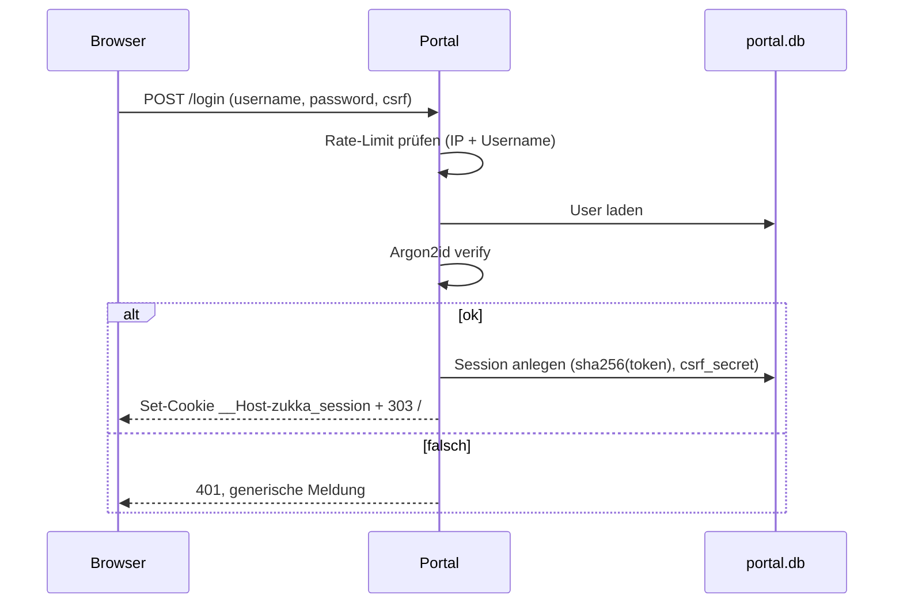
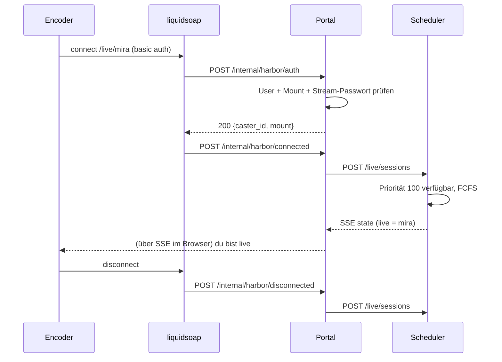

# Portal

Caster-Portal für radio zukka v2. Rust, `axum` + `askama` + `htmx` + `sqlx`.
Dieses Dokument ist der Detail-Plan: Entscheidungen, Schnittstellen, Risiken,
Umsetzung. Verbindliche Datenverträge entstehen in
[`data-model.md`](data-model.md); wo dieses Dokument Verträge _vorschlägt_, ist
das markiert.

## 1. Scope

### 1.1 Im Scope

| Bereich           | Inhalt                                                                                     |
| ----------------- | ------------------------------------------------------------------------------------------ |
| **Auth**          | Login (eigenes Konto), separates Caster-/Stream-Passwort, Sessions, CSRF, RBAC             |
| **Upload**        | Datei → Music API (Object Storage), Metadaten, Formatprüfung, Konvertierung, Waveform      |
| **Library**       | gemeinsame + private Library, Suche, Filter, Waveform-Anzeige                              |
| **Queue-UI**      | Queues pro Caster (benannt), Tracks hinzufügen/umsortieren/skippen, YouTube-/Spotify-Links |
| **Schedule**      | Shows, Broadcasts (Start/Ende optional), Wiederholung, Kalender, Konflikte                 |
| **Control Panel** | Live-State, manuelles Umschalten, Pause/Skip                                               |
| **Announcements** | Templates mit Platzhaltern, Timings, Events, manuelles Posten                              |
| **UI**            | Seitenstruktur, askama-Partials, htmx-Verhalten, CSS                                       |

### 1.2 Nicht im Scope

- **Audio-Engine** (Harbor, `request.dynamic`, `switch`, Crossfade, Recording) → `liquidsoap.md`
- **Queue-/Schedule-/Prioritäts-_Logik_** → `scheduler`. Das Portal ist Bedienoberfläche, nicht Entscheider.
- **Datei-Autorität** → `music-api`. Das Portal speichert keine Audio-Dateien dauerhaft.
- **Öffentlicher Feed / Waveform-Wiedergabe für Hörer** → `tapes.md`
- **Deployment, Env, Caddy, systemd** → `infrastructure.md`
- **Streaming-Ausgabe** → `icecast` / `caddy`

### 1.3 Grundhaltung

Das Portal ist **dünn**: es hält Identität, Upload-Pipeline und UI-State. Alles,
was Programm ist (was läuft wann, in welcher Reihenfolge, mit welcher
Priorität), gehört dem `scheduler`. Alles, was Datei ist, gehört der `music-api`.
Diese Trennung ist die wichtigste Design-Entscheidung des Dokuments und
begründet die meisten folgenden Festlegungen.

## 2. Entscheidungen

### D1 — Zwei Autoritäten, zwei Datenbanken

Das Portal hat eine **eigene SQLite-DB** (`portal.db`) und ist Autorität für
**Identität** (User, Sessions, Stream-Passwörter, Sichtbarkeit von Tracks).
Der `scheduler` behält seine DB und ist Autorität für **Programm** (Queues,
Broadcasts, Announcements, Live-Auswahl).

_Begründung:_ Zwei Prozesse, die dieselbe SQLite-Datei schreiben, erzeugen
Locking- und Migrations-Chaos. Getrennte DBs erlauben unabhängige Deploys.

_Konsequenz:_ Keine Foreign Keys über DB-Grenzen. User-IDs sind **opake
UUIDv7-Strings**, die der Scheduler speichert, ohne sie zu interpretieren.
Anzeigenamen holt er bei Bedarf über `GET /internal/users/{id}`.

### D2 — Login-Passwort und Caster-Passwort sind getrennt und müssen sich unterscheiden

- `users.password_hash` — Argon2id, für das Portal-Login.
- `users.stream_password_hash` — Argon2id, eigener Hash, für den Harbor-Login
  des Encoders. Wird nie im Klartext gespeichert, nur einmalig angezeigt.
- Beim Setzen **beider** Passwörter prüft der Server per `argon2::verify`, dass
  das neue Passwort nicht dem jeweils anderen entspricht → `422` mit
  Feldfehler. Das ist eine harte Regel, nicht nur ein UI-Hinweis.

_Begründung:_ Ein geleaktes Stream-Passwort (steht in Encoder-Configs, wird
herumgereicht) darf keinen Portal-Zugang öffnen — und umgekehrt.

### D3 — Server-seitige Sessions, eigenes Cookie

Kein JWT, kein `tower-sessions`. Eigene Tabelle `sessions`, weil wir
Revocation, „alle Sessions beenden" und Audit brauchen.

- Cookie `__Host-zukka_session`, `HttpOnly`, `Secure`, `SameSite=Lax`, `Path=/`, kein `Domain`.
- Wert: 32 Byte Zufall (base64url). In der DB steht nur `sha256(wert)`.
- Idle-Timeout 7 Tage, absolutes Limit 30 Tage. Rotation bei Login und bei
  Rollen-/Passwortänderung.
- `__Host-`-Präfix erzwingt HTTPS + `Path=/` + kein `Domain` — dadurch bricht
  die Session bei Fehlkonfiguration sofort sichtbar, statt still unsicher zu sein.

### D4 — CSRF: Token pro Session + Origin-Prüfung

- Pro Session ein `csrf_secret`; das an den Client ausgelieferte Token ist
  `HMAC(csrf_secret, "csrf")`, eingebettet in `<meta name="csrf-token">`.
- htmx setzt es global über `hx-headers` am `<body>`; klassische Formulare
  tragen es als Hidden-Feld.
- Jede Nicht-GET-Anfrage wird geprüft: Token-Vergleich (`subtle`) **und**
  `Sec-Fetch-Site: same-origin` (bzw. `Origin`-Header, wenn vorhanden).
- Fehler → `403`, kein Redirect.

### D5 — RBAC als Permissions, nicht als Rollen-Checks im Code

Rollen (`admin`, `operator`, `caster`) mappen auf Permission-Strings; Handler
prüfen nur Permissions. Permissiv by default: `caster` darf alles außer
Fremd-Verwaltung und Control-Write.

| Permission           | caster | operator | admin |
| -------------------- | :----: | :------: | :---: |
| `library.read`       |   ✓    |    ✓     |   ✓   |
| `library.upload`     |   ✓    |    ✓     |   ✓   |
| `library.delete`     |   –    |    ✓     |   ✓   |
| `queue.write.own`    |   ✓    |    ✓     |   ✓   |
| `queue.write.any`    |   –    |    ✓     |   ✓   |
| `show.write`         |   ✓    |    ✓     |   ✓   |
| `broadcast.write`    |   ✓    |    ✓     |   ✓   |
| `control.read`       |   ✓¹   |    ✓     |   ✓   |
| `control.write`      |   –    |    ✓     |   ✓   |
| `announcement.write` |   ✓    |    ✓     |   ✓   |
| `user.manage`        |   –    |    ✓     |   ✓   |
| `settings.manage`    |   –    |    –     |   ✓   |

¹ nur der eigene Live-Status (Dashboard-Badge), nicht das volle Control Panel.

### D6 — Upload: Streaming, nie im RAM; Music API ist das Ziel

Multipart-Upload → Temp-Datei auf Platte (Streaming, harte Größenlimits) →
`ffprobe` → ggf. Transcode → Upload in die Music API → Waveform → DB-Zeile.
Der Job-Status liegt in `upload_jobs` und überlebt einen Neustart.

### D7 — Master bleibt Master, Derivat nur bei Bedarf

Das Original wird unverändert als Master in der Music API abgelegt.
Ein **Stream-Derivat** (MP3 320 CBR, 44,1 kHz, stereo) wird nur erzeugt, wenn
(a) der Codec nicht in der akzeptierten Menge liegt oder (b) der Container eine
Videospur enthält (z. B. `webm`/`mp4` aus Link-Auflösung).

Akzeptierte Master-Codecs: `mp3`, `flac`, `vorbis`, `opus`, `aac`, `alac`, `pcm_s16le/s24le`, `aiff`.

_Begründung:_ FLAC-Master sollen nicht durch MP3-Transcoding entwertet werden;
gleichzeitig muss Liquidsoap alles dekodieren können.

### D8 — Waveform-Peaks gehören dem Portal

Peaks werden beim Upload berechnet (`ffmpeg` → mono 8 kHz PCM → 800
Min/Max-Buckets, 8 bit) und in `track_waveform` als kompaktes JSON gespeichert.
Ausgeliefert als `GET /library/tracks/{id}/waveform.json`, gerendert als
Inline-SVG.

_Begründung:_ Die Music API ist Datei-Autorität, nicht Peak-Store; ein
Peak-Feld dort wäre ein API-Eingriff. `tapes` kann denselben Endpunkt nutzen
oder eigenständig rechnen — offene Frage Q4.

### D9 — Queues gehören dem Scheduler, das Portal ist Editor

Queue-Objekte (`owner_caster_id`, `name`, `is_default`) und Items liegen im
Scheduler. Das Portal ruft CRUD-Endpunkte auf und rendert die zurückgegebenen
Fragmente. **Der Server ist immer die Wahrheit**; die UI ist optimistisch, aber
nicht führend.

Positionierung: ganzzahlige `position` mit Schrittweite 1000, Reindex bei
Erschöpfung. Einfacher als fraktionale Werte und in SQLite gut indizierbar.

### D10 — Links sind Queue-Items mit eigenem Typ

Ein Queue-Item ist `track` (Music-API-ID), `link` (Provider + URL, optional
aufgelöste `track_id`) oder `jingle` (Track mit Rolle). Links werden
asynchron aufgelöst: `pending` → `ready` / `failed`.

- **YouTube:** Auflösung zu Audio-Asset in der Music API (Worker im Scheduler,
  nicht im Portal). Nicht auflösbar → Item bleibt `failed`, UI zeigt Grund.
- **Spotify:** **nicht abspielbar** (kein Audio-Zugriff ohne DRM-Umgehung).
  Spotify-Items sind `playable=false` und dienen als Merkzettel/Playlist-Import
  für die Redaktion. Das muss die UI klar sagen, nicht verstecken.

### D11 — Schedule: RRULE im Scheduler, Kalender im Portal

Shows und Broadcasts gehören dem Scheduler. Wiederholung als **RRULE-Teilmenge**
(`FREQ=DAILY|WEEKLY|MONTHLY`, `INTERVAL`, `BYDAY`, `COUNT`, `UNTIL`), verankert
in `Europe/Berlin`. Expansion passiert im Scheduler; das Portal fragt ein
Zeitfenster ab (`GET /schedule?from=&to=`) und rendert.

`start_at` und `end_at` sind beide optional: ein Broadcast ohne Ende ist
„läuft, bis jemand übernimmt" (typisch live). Der Kalender rendert das als
offenen Balken.

### D12 — Konflikte sind Warnungen, keine Blocker

Überlappende Broadcasts werden erkannt und angezeigt, aber **nicht verhindert**
(Piratenradio). Ausnahmen, die hart blockieren:

- dieselbe Show überlappt sich selbst,
- ein Broadcast mit `end_at` vor `start_at`,
- ein `playlist`-Broadcast ohne `queue_id`.

Live-Überlappung ist erlaubt und wird als Hinweis gezeigt („nur einer kann
live sein, first come, first served").

### D13 — Zeitzone: UTC speichern, Berlin rendern

Alle Zeitpunkte in der DB als UTC (RFC 3339). Jede Anzeige und jedes
Formular-Feld in `Europe/Berlin` via `chrono-tz`. Keine hartkodierten Offsets.

DST-Sonderfälle, explizit festgelegt:

- **nicht existierende** lokale Zeit (Frühjahrs-Umstellung) → um +1 h
  verschieben, Warnung im Formular.
- **doppelte** lokale Zeit (Herbst-Umstellung) → erste Occurrence, Warnung.

### D14 — Live-State: Portal sammelt, Scheduler entscheidet

Der Harbor-Auth läuft über das Portal (es kennt die Passwörter). Das Portal
führt `live_sessions` (wer ist verbunden, seit wann, welcher Mount) und
**pusht** Änderungen an den Scheduler (`POST /live/sessions`). Welche Quelle
ausgegeben wird, entscheidet ausschließlich der Scheduler.

_Begründung:_ Identität bleibt an einer Stelle; die Ausgabe-Logik bleibt an
einer Stelle. Kein doppeltes „wer ist live"-Buch.

### D15 — Control Panel per SSE, Fallback Polling

`GET /control/events` (SSE) liefert Zustands-Deltas; htmx-SSE-Extension
swappt die Fragmente. Fallback: `hx-trigger="every 3s"` auf dem State-Container,
wenn `EventSource` fehlt oder die Verbindung abbricht.

Caddy muss für diesen Pfad Buffering aus haben (`flush_interval -1`) — sonst
klebt das Panel. Das ist ein Deployment-Detail für `infrastructure.md`, hier
nur als Anforderung notiert. Umgesetzt in `deploy/caddy/routes.caddy`: die
Portal-Domain hat einen expliziten `handle /control/events` mit
`flush_interval -1` (Issue #22, US-7).

### D16 — Control-Aktionen sind sofort und rückholbar

Umschalten/Pause/Skip gehen direkt an den Scheduler, ohne Bestätigungsdialog
(„kein Delay"). Stattdessen: Toast mit „Rückgängig" für 10 s, das die vorherige
Quelle wiederherstellt. Jede Aktion wird auditiert (wer, was, vorher/nachher).

### D17 — Announcements: Scheduler sendet, Portal editiert

Events (`live.on`, `live.off`, `show.reminder`, `recording.published`,
`fallback.entered`, `error`) entstehen im Scheduler. Templates, Timings und
Versand liegen dort. Das Portal ist Editor + Vorschau + manueller Auslöser
(`POST /announcements/send`).

_Begründung:_ Wer die Events kennt, soll sie senden. Zwei Sender wären zwei
Wahrheiten über „wurde schon gepostet".

### D18 — htmx-first, genau eine JS-Abhängigkeit

Alles serverseitig gerendert. Vendored: `htmx.min.js` (2.x), `htmx-ext-sse.js`,
`SortableJS` (nur für Queue-Drag&Drop). Kein Build-Step, kein CDN, kein
Framework. Drag&Drop hat immer eine tastatur- und no-JS-taugliche Alternative
(↑/↓-Buttons, die dieselben Endpunkte treffen).

### D19 — Kein E-Mail-Versand

Passwort-Reset läuft über Admin (temporäres Passwort + `must_change_password`).
Break-Glass: CLI-Subkommando `portal admin reset --user <name>`, das direkt auf
`portal.db` arbeitet. Ohne das kann sich die Installation aussperren.

### D20 — Fehler und Leerzustände sind Teil der UI

Jede Seite hat definierte Leerzustände („noch keine Queue", „Library leer"),
Feldfehler werden inline im Formular gerendert (askama-Partial
`form_errors.html`), und Fehler-Toasts kommen über den `HX-Trigger`-Header.
Kein `unwrap()` in Handlern; `anyhow` intern, `PortalError` als
`IntoResponse`-Typ mit nutzerlesbarer Meldung + `tracing`-Span.

## 3. Schnittstellen

### 3.1 Stack

| Baustein    | Wahl                                                                    | Zweck                                        |
| ----------- | ----------------------------------------------------------------------- | -------------------------------------------- |
| HTTP        | `axum` 0.8                                                              | Router, Extractors, Multipart, SSE           |
| Templates   | `askama` 0.14                                                           | compile-time Templates, typisierte Structs   |
| Interaktion | `htmx` 2.x + SSE-Ext                                                    | Fragmente, Live-Updates                      |
| DnD         | `SortableJS`                                                            | Queue-Umsortierung                           |
| DB          | `sqlx` 0.8 + SQLite (WAL)                                               | `portal.db`, `sqlx::migrate!`, offline-Modus |
| Auth        | `argon2`, `rand`, `subtle`, `sha2`                                      | Hashing, Tokens, Konstantzeit-Vergleich      |
| Zeit        | `chrono` + `chrono-tz`                                                  | UTC ↔ `Europe/Berlin`                        |
| HTTP-Client | `reqwest` (rustls)                                                      | Music API, Scheduler                         |
| Media       | `ffmpeg` / `ffprobe` als Subprozess                                     | Probe, Transcode, Peaks                      |
| Middleware  | `tower-http` (trace, compression, static, request-id), `tower_governor` | Betrieb, Rate-Limits                         |
| Logging     | `tracing` + `tracing-subscriber`                                        | strukturierte Logs                           |
| IDs         | `uuid` v7                                                               | sortierbar, DB-freundlich                    |

`askama` liefert `Template`; die `IntoResponse`-Implementierung entweder über
`askama_web` (`web-axum`) oder als kleiner eigener Wrapper — beim
Projekt-Setup festlegen, nicht beides.

### 3.2 Seiten (HTML)

Alle Pfade unter eigenem Host (`studio.<domain>`), damit das
`__Host-`-Cookie sauber scoped ist. Pfadparameter in axum-0.8-Syntax `{id}`.

| Methode | Pfad                               | Seite                                                    | Permission               |
| ------- | ---------------------------------- | -------------------------------------------------------- | ------------------------ |
| GET     | `/`                                | Dashboard: eigene Queues, nächster Broadcast, Live-Badge | login                    |
| GET     | `/login`                           | Login-Formular                                           | –                        |
| POST    | `/login`                           | Login                                                    | –                        |
| POST    | `/logout`                          | Logout (CSRF-geschützt)                                  | login                    |
| GET     | `/account`                         | Konto: Passwort ändern, Stream-Zugang                    | login                    |
| POST    | `/account/password`                | Login-Passwort ändern                                    | login                    |
| POST    | `/account/stream-password`         | Stream-Passwort neu setzen                               | login                    |
| GET     | `/library`                         | Library: Suche, Filter, Liste                            | `library.read`           |
| GET     | `/library/upload`                  | Upload-Formular                                          | `library.upload`         |
| POST    | `/library/upload`                  | Upload (multipart, mehrere Dateien)                      | `library.upload`         |
| GET     | `/library/tracks/{id}`             | Track-Detail: Waveform, Metadaten, „in Queue"            | `library.read`           |
| POST    | `/library/tracks/{id}/visibility`  | shared/private umschalten                                | `library.upload`         |
| POST    | `/library/tracks/{id}/delete`      | Track löschen (Music API)                                | `library.delete`         |
| GET     | `/queues`                          | Queue-Übersicht (eigene + fremde lesbar)                 | login                    |
| POST    | `/queues`                          | Queue anlegen                                            | `queue.write.own`        |
| GET     | `/queues/{id}`                     | Queue-Editor                                             | login                    |
| POST    | `/queues/{id}/items`               | Track/Link hinzufügen                                    | `queue.write.own`/`.any` |
| POST    | `/queues/{id}/items/{item}/move`   | Umsortieren (`before_id`/`after_id`)                     | s. o.                    |
| POST    | `/queues/{id}/items/{item}/delete` | Entfernen                                                | s. o.                    |
| POST    | `/queues/{id}/skip`                | Skip (global control)                                    | `control.write`          |
| POST    | `/queues/{id}/rename`              | Umbenennen                                               | s. o.                    |
| GET     | `/shows`                           | Show-Liste                                               | login                    |
| GET     | `/shows/{id}`                      | Show-Detail                                              | login                    |
| POST    | `/shows`                           | Show anlegen                                             | `show.write`             |
| POST    | `/shows/{id}`                      | Show bearbeiten                                          | `show.write`             |
| GET     | `/schedule`                        | Kalender (Woche/Monat, Berlin)                           | login                    |
| GET     | `/schedule/new`                    | Broadcast-Formular                                       | `broadcast.write`        |
| POST    | `/schedule`                        | Broadcast anlegen                                        | `broadcast.write`        |
| POST    | `/schedule/{id}`                   | Broadcast bearbeiten                                     | `broadcast.write`        |
| POST    | `/schedule/{id}/start`             | Broadcast starten (`scheduled`→`live`)                   | `broadcast.write`        |
| POST    | `/schedule/{id}/end`               | Broadcast beenden (`live`→`ended`)                       | `broadcast.write`        |
| POST    | `/schedule/{id}/cancel`            | Broadcast abbrechen (`scheduled`/`live`→`cancelled`)     | `broadcast.write`        |
| POST    | `/schedule/{id}/delete`            | Broadcast löschen                                        | `broadcast.write`        |
| GET     | `/control`                         | Control Panel                                            | `control.read`           |
| POST    | `/control/source`                  | Quelle umschalten                                        | `control.write`          |
| POST    | `/control/pause`                   | Pause/Resume                                             | `control.write`          |
| POST    | `/control/skip`                    | Skip                                                     | `control.write`          |
| GET     | `/announcements`                   | Template-Liste + Versand-Log                             | `announcement.write`     |
| GET     | `/announcements/templates/{id}`    | Template-Editor + Vorschau                               | `announcement.write`     |
| POST    | `/announcements/templates/{id}`    | Template speichern                                       | `announcement.write`     |
| POST    | `/announcements/send`              | Manuell posten                                           | `announcement.write`     |
| GET     | `/admin/users`                     | Caster-Verwaltung                                        | `user.manage`            |
| POST    | `/admin/users`                     | Caster anlegen                                           | `user.manage`            |
| POST    | `/admin/users/{id}`                | Caster bearbeiten (Rolle, aktiv, Reset)                  | `user.manage`            |
| GET     | `/admin/settings`                  | Globale Einstellungen                                    | `settings.manage`        |

### 3.3 htmx-Fragmente

Fragmente sind **dieselben Routen** mit `?fragment=<name>` (oder
`HX-Request`-Header-Erkennung) und liefern nur das Partial. Keine separaten
`/fragments/...`-Bäume — sonst driften Seite und Fragment auseinander.

| Fragment               | Auslöser                                | Inhalt                              |
| ---------------------- | --------------------------------------- | ----------------------------------- |
| `queue-list`           | `every 5s`, nach jeder Mutation         | Items + Positionen                  |
| `queue-item`           | Mutation eines Items                    | eine Zeile                          |
| `library-results`      | `keyup changed delay:300ms` im Suchfeld | Trefferliste + Paging               |
| `upload-job`           | `every 1s` solange `pending`/`running`  | Status, Fortschritt, Fehler         |
| `calendar-grid`        | Navigation Woche/Monat                  | Kalender                            |
| `broadcast-form`       | Datumswechsel                           | Konflikt-Warnungen inline           |
| `control-state`        | SSE `state`, Fallback `every 3s`        | Quellen, Live-Sessions, Now-Playing |
| `live-badge`           | SSE `state`                             | „du bist live"-Indikator            |
| `announcement-preview` | `keyup changed delay:400ms`             | gerenderte Vorschau                 |
| `toast`                | `HX-Trigger`-Header                     | Erfolg/Fehler                       |

htmx-Konventionen: `hx-boost` auf der Navigation, `hx-push-url` für
Listen/Detail, `hx-indicator` für Spinner, `hx-swap="outerHTML"` als Default,
`hx-confirm` nur bei Löschen, `HX-Trigger: {"toast": {...}}` für Rückmeldungen.

### 3.4 Interne JSON-API (nur Loopback)

Für Liquidsoap und Scheduler. Bind nur auf `127.0.0.1`, Auth über
`Authorization: Bearer <INTERNAL_TOKEN>` (konstantzeitlich verglichen), plus
`X-Request-Id` für Korrelation.

| Methode | Pfad                            | Zweck                               |
| ------- | ------------------------------- | ----------------------------------- |
| POST    | `/internal/harbor/auth`         | Harbor-Login prüfen                 |
| POST    | `/internal/harbor/connected`    | Caster verbunden                    |
| POST    | `/internal/harbor/disconnected` | Caster getrennt                     |
| GET     | `/internal/users/{id}`          | Anzeigename/Rolle für Announcements |
| GET     | `/internal/health`              | Liveness für Liquidsoap-Startup     |

`POST /internal/harbor/auth`

```json
{ "mount": "/live/mira", "username": "mira", "password": "…" }
```

Antwort `200`:

```json
{ "caster_id": "0192f0…", "display_name": "Mira", "mount": "/live/mira" }
```

Antwort `401` bei falschem Passwort, `403` bei inaktivem User oder falschem
Mount, `429` bei Rate-Limit. **Muss in < 200 ms antworten**, sonst weist
Liquidsoap die Verbindung ab — deshalb genau eine Argon2-Verifikation pro
Versuch, kein Datenbank-Roundtrip mehr als nötig.

### 3.5 Konsumierte APIs

**Scheduler** (Contract-Vorschlag, verbindlich in `data-model.md`):

```
GET    /state                          aktive Quelle, Layer, Now-Playing, Next
GET    /queues?owner={caster_id}
POST   /queues                         {owner_caster_id, name}
PATCH  /queues/{id}
DELETE /queues/{id}
GET    /queues/{id}/items
POST   /queues/{id}/items              {kind, track_id|provider+url, position}
PATCH  /queues/{id}/items/{item}
DELETE /queues/{id}/items/{item}
POST   /queues/{id}/items/{item}/move  {before_id|after_id}
POST   /queues/{id}/skip
GET    /shows            POST /shows            PATCH /shows/{id}
GET    /schedule?from=&to=
POST   /broadcasts       PATCH /broadcasts/{id} DELETE /broadcasts/{id}
POST   /broadcasts/{id}/start  POST /broadcasts/{id}/end  POST /broadcasts/{id}/cancel
GET    /announcements/templates
PUT    /announcements/templates/{id}
POST   /announcements/send             {template_id, context}
POST   /live/sessions                  Portal → Scheduler (Push)
POST   /control/source                 {source: {kind, id}}
POST   /control/pause                  {paused: bool}
POST   /control/skip
GET    /control/events                 SSE
```

**Music API** (verifiziert gegen `music-api` — kein `/api/v1`-Präfix; gelöst, ehemals Q1):

```
PUT    /objects/{sha256}           Binär-Body (streaming), idempotent
HEAD   /objects/{sha256}           Dedupe (200 vorhanden / 404 neu)
GET    /objects/{hash}             Objekt-Bytes (Range-fähig)
GET    /isrc/{isrc}/{flac|320|128} Abspiel-URL für Liquidsoap (Track mit ISRC)
GET    /tracks?isrcs=a,b,c         Batch-Lookup (nur ISRC-Liste)
POST   /work                       {kind: "analyze"|"download", ref}
```

`PUT /objects/{sha256}` streamt die Bytes von Platte und trägt optional
`X-ISRC`, `X-Name`, `X-Original-Path`. Ein vorhandenes Objekt wird nicht
überschrieben (`{"stored":false,"present":true}`). Es gibt **kein**
`POST /tracks`, `PUT /tracks/{id}/asset`, `DELETE /tracks/{id}` oder
`/tracks/by-hash/{sha256}`.

Das Portal kapselt das in einem `MusicApi`-Trait (`has_object`, `put_object`,
`enqueue_work`), damit ein abweichender Contract nur eine Datei betrifft.

### 3.6 Auth-Abläufe

**Login**



Kein User-Enumeration: gleiche Meldung und gleiche Zeit für „unbekannt" und
„falsches Passwort" (Blind-Verify gegen Dummy-Hash).

**Harbor-Login und Live-State**



**Stream-Passwort setzen:** `POST /account/stream-password` erzeugt auf Wunsch
ein 24-Zeichen-Passwort (base32), zeigt es **einmal**, speichert nur den Hash.
Eine laufende Harbor-Verbindung wird **nicht** getrennt („kein Kick/Bann") —
das neue Passwort gilt ab der nächsten Verbindung.

**Cockpit-WebSocket-Bridge (#148)**

- Endpoint: `GET /api/v1/control/ws` (siehe `control-api.md` §2.2/§6).
- Liegt **außerhalb** der `protected`-Layer: ein WS-Upgrade darf nicht mit
  `303 /login` beantwortet werden; Auth passiert **in-band**.
- Auth-Reihenfolge: `Authorization: Bearer <SERVICE_TOKEN>` → Portal-Session-
  Cookie (`control.read`) → Erst-Frame `{"type":"auth","token":"…"}`.
- Close-Codes: `4401` (fehlende/ungültige Auth), `4408` (Pong-Timeout 30 s),
  `4503` (`engine_unavailable`).
- **Write-Gate:** Cookie-Sessions dürfen Engine-Writes nur mit `control.write`
  (§6.10.1); sonst antwortet die Bridge `forbidden` und mutiert die Engine nicht.
  Service-Token-Sitzungen haben Vollzugriff.

### 3.7 Datenmodell `portal.db`

Nur Identität, Upload, Sichtbarkeit, Peaks. Programm-Daten liegen im Scheduler.

```
users(id TEXT PK, username TEXT UNIQUE, display_name TEXT, role TEXT,
      password_hash TEXT, stream_password_hash TEXT, stream_mount TEXT,
      must_change_password INTEGER, is_active INTEGER,
      created_at TEXT, updated_at TEXT, last_login_at TEXT)

sessions(token_hash TEXT PK, user_id TEXT, csrf_secret BLOB,
         created_at TEXT, last_seen_at TEXT, idle_expires_at TEXT,
         absolute_expires_at TEXT, ip TEXT, user_agent TEXT)

library_visibility(track_id TEXT PK, owner_id TEXT, visibility TEXT,
                   created_at TEXT)          -- fehlende Zeile = shared

upload_jobs(id TEXT PK, user_id TEXT, filename TEXT, size_bytes INTEGER,
            sha256 TEXT, state TEXT,            -- pending|running|done|failed
            track_id TEXT, error TEXT, attempts INTEGER,
            created_at TEXT, updated_at TEXT)

track_waveform(track_id TEXT PK, peaks BLOB, buckets INTEGER,
               duration_ms INTEGER, computed_at TEXT)

audit_log(id TEXT PK, at TEXT, actor_id TEXT, action TEXT,
          target TEXT, detail TEXT, ip TEXT)

settings(key TEXT PK, value TEXT)
```

Indizes: `sessions(user_id)`, `sessions(idle_expires_at)`,
`upload_jobs(state)`, `library_visibility(owner_id, visibility)`,
`audit_log(at)`.

### 3.8 UI-Struktur

```
templates/
  layout.html            Grundgerüst, Nav, CSRF-Meta, htmx-Header
  partials/
    nav.html             Rollenabhängige Navigation
    live_badge.html      „du bist live" / „X ist live"
    track_row.html       Track-Zeile (Titel, Dauer, Waveform-Mini, Aktionen)
    waveform.html        Inline-SVG aus Peaks
    queue_list.html      Queue-Items, SortableJS-Hook
    queue_item.html      eine Zeile inkl. Link-Status
    library_results.html Trefferliste + Paging
    upload_job.html      Fortschritt/Fehler
    calendar_grid.html   Woche/Monat, Berlin-Labels
    broadcast_card.html  Slot im Kalender
    conflict_warning.html
    control_state.html   Quellen, Sessions, Now-Playing
    announcement_preview.html
    form_errors.html
    toast.html
    empty_state.html
    pagination.html
  pages/
    dashboard.html  login.html  account.html
    library.html  library_upload.html  track_detail.html
    queues.html  queue_editor.html
    shows.html  show_detail.html
    schedule.html  broadcast_form.html
    control.html
    announcements.html  announcement_editor.html
    admin_users.html  admin_settings.html
```

CSS: ein handgeschriebenes Stylesheet mit Custom Properties, dark-first, keine
Utility-Framework-Abhängigkeit. Fokus auf Lesbarkeit bei Nacht und
Tastaturbedienbarkeit (sichtbarer Fokusring, `aria-live` für Toasts und
Live-Badge).

### 3.9 Konfiguration (Namen, Werte in `infrastructure.md`)

```
PORTAL_ADDR=127.0.0.1:8081
PORTAL_DB=sqlite:///var/lib/zukka/portal.db
PORTAL_BASE_URL=https://studio.<domain>
SCHEDULER_URL=http://127.0.0.1:8082
MUSIC_API_URL=…
MUSIC_API_TOKEN=…
INTERNAL_TOKEN=…
UPLOAD_MAX_BYTES=524288000
UPLOAD_TMP_DIR=/var/lib/zukka/tmp
FFMPEG_BIN=ffmpeg
FFPROBE_BIN=ffprobe
SESSION_IDLE_DAYS=7
SESSION_ABSOLUTE_DAYS=30
```

## 4. Offene Fragen

| #   | Frage                                                                                            | Blockiert       | Vorschlag                                                                                              |
| --- | ------------------------------------------------------------------------------------------------ | --------------- | ------------------------------------------------------------------------------------------------------ |
| Q1  | Exakter Music-API-Contract (Upload-Mechanismus, Suche, Hash-Lookup, Delete, Abspiel-URL)         | Upload, Library | **gelöst**: `PUT/HEAD/GET /objects/{hash}`, `GET /isrc/{isrc}/{format}`, `GET /tracks?isrcs=`, `POST /work`; kein `/api/v1` (#134) |
| Q2  | Semantik „shared vs. private": darf ein privater Track on air laufen?                            | Library, Queue  | Vorschlag: privat = nur sichtbar für Owner/Operator; Abspielbarkeit unabhängig (Sichtbarkeit ≠ Lizenz) |
| Q3  | Mount-Vergabe: statischer Pool vs. dynamische Harbor-Mounts                                      | Auth, Live      | Portal geht von statischem Pool aus; Verfahren gehört in `liquidsoap.md`                               |
| Q4  | Wo leben Waveform-Peaks langfristig (Portal vs. Music-API-Metadaten)? `tapes` braucht sie auch   | Library, tapes  | Vorschlag: Portal ist Peak-Store, `tapes` liest den Endpunkt                                           |
| Q5  | Link-Auflösung: rechtliche/ToS-Bewertung von YouTube-Downloads; Spotify endgültig nur Metadaten? | Queue           | Entscheidung der Betreiber, nicht des Portals                                                          |
| Q6  | Wer darf Tracks löschen (Music API ist Autorität, Portal nur UI)?                                | Library         | Vorschlag: `library.delete` ab Operator, Soft-Delete im Portal-Log                                     |
| Q7  | „Du bist live"-Kommunikation: nur UI-Badge oder auch Telegram?                                   | Announcements   | Vorschlag: beides, Telegram über Scheduler-Event                                                       |
| Q8  | Recording-Opt-in pro Broadcast (wer schaltet `record` ein)?                                      | Schedule, tapes | Vorschlag: Feld am Broadcast, Ausführung im Scheduler                                                  |
| Q9  | 2FA für `admin`/`operator`?                                                                      | Auth            | Vorschlag: TOTP später, Schema (`totp_secret`) jetzt schon vorsehen                                    |
| Q10 | Aufbewahrung von Upload-Mastern und Temp-Dateien (Retention, Disk-Budget)                        | Upload          | Vorschlag: Temp nach 24 h räumen, Master unbegrenzt                                                    |
| Q11 | Braucht das Portal eine eigene DB oder teilt es `scheduler.db`?                                  | Architektur     | Entscheidung D1: getrennt — in `data-model.md` bestätigen                                              |
| Q12 | Mehrere Queues pro Caster oder genau eine?                                                       | Queue-UI        | Vorschlag: mehrere, genau eine als `is_default`                                                        |

## 5. Risiken

| Risiko                                                                 | Wirkung                                           | Gegenmaßnahme                                                                                   |
| ---------------------------------------------------------------------- | ------------------------------------------------- | ----------------------------------------------------------------------------------------------- |
| **Zwei Autoritäten driften** (Portal-Identität vs. Scheduler-Programm) | Verwaiste Queues, falsche Anzeigenamen            | Opaque IDs, keine Cross-DB-FKs, Integrationstest gegen laufenden Scheduler                      |
| **Argon2 im Harbor-Auth-Pfad**                                         | Verbindungsaufbau > 200 ms → Liquidsoap weist ab  | Ein Verify pro Versuch, Argon2-Parameter moderat (19 MiB, t=2), Latenz messen                   |
| **ffmpeg-Transcodes sprengen CPU**                                     | Aussetzer im Stream, hängende Uploads             | Worker-Pool = 2, `nice`, Job-Queue in DB, Backpressure im UI                                    |
| **Große Uploads füllen die Platte**                                    | Portal und Stream sterben                         | Streaming in Temp-Datei, `UPLOAD_MAX_BYTES`, Disk-Guard vor Annahme, Temp-Cleanup               |
| **SSE durch Caddy gepuffert**                                          | Control Panel zeigt veralteten Zustand            | `flush_interval -1` für `/control/events`, Fallback-Polling bleibt aktiv                        |
| **Cookie-Fehlkonfiguration** (`__Host-` + Proxy)                       | Login „funktioniert nicht", schwer zu debuggen    | `__Host-` bewusst gewählt: bricht laut statt still; Startup-Check auf `PORTAL_BASE_URL` = https |
| **DST-Kanten im Schedule**                                             | Broadcast zur falschen Zeit                       | UTC-Speicherung, explizite DST-Policy (D13), Tests für beide Umstellungswochen                  |
| **yt-dlp bricht bei Provider-Änderung**                                | Queue-Items hängen auf `pending`                  | Status sichtbar, Retry mit Backoff, manuelles Entfernen möglich                                 |
| **Permissives RBAC**                                                   | Jeder Caster kann fremde Broadcasts überschreiben | Konflikt-Warnungen, Audit-Log, `queue.write.any` nur ab Operator                                |
| **Kein E-Mail-Reset**                                                  | Aussperrung bei vergessenem Admin-Passwort        | Break-Glass-CLI (D19), dokumentiert in `infrastructure.md`                                      |
| **htmx + DnD-Zustandsdrift**                                           | UI zeigt andere Reihenfolge als DB                | Server liefert nach jeder Mutation das autoritative Fragment zurück                             |
| **Waveform-Berechnung für große Libraries**                            | Lange Jobs, hohe Last                             | Lazy-Berechnung für Fremd-Tracks, Priorität für zuletzt genutzt                                 |

## 6. Umsetzungsschritte

Jeder Schritt endet mit lauffähigem Stand auf `v2`, nicht mit halben Features.

**P0 — Gerüst**
Crate `portal/`, Config-Laden, `tracing`, `/health`, `sqlx`-Migrations,
`layout.html` + CSS + vendored htmx, Fehlertyp `PortalError`, 404/500-Seiten.
_DoD:_ `cargo run` liefert eine gestylte Startseite, `cargo clippy` sauber.

**P1 — Auth & RBAC**
`users`/`sessions`/`audit_log`, Login/Logout, Session-Middleware, CSRF,
Permission-Matrix, Admin-User-CRUD, Stream-Passwort (Erzeugung, Einmal-Anzeige,
Ungleichheits-Prüfung), Rate-Limits, Break-Glass-CLI.
_DoD:_ Login, Logout, 403 auf `/admin` als Caster, CSRF-Ablehnung getestet.

**P2 — Music API & Upload**
`MusicApi`-Trait + Client, `upload_jobs`, Multipart-Streaming, `ffprobe`,
Transcode-Regel (D7), Dedupe per SHA-256, Waveform-Peaks, Job-UI mit Polling.
_DoD:_ FLAC und `webm` hochladen → Track in Music API, Peaks sichtbar,
Neustart mitten im Job hinterlässt keinen Zombie.

**P3 — Library**
Suche/Filter (Query an Music API + Sichtbarkeits-Overlay), Track-Detail,
Waveform-Rendering, „in Queue"-Aktion, Sichtbarkeit umschalten.
_DoD:_ Suche < 300 ms bei 5 000 Tracks, private Tracks für Fremde unsichtbar.

**P4 — Queues**
Queue-CRUD, Items (Track/Link/Jingle), Umsortieren (htmx + SortableJS +
↑/↓-Fallback), Skip, Link-Status-Anzeige.
_DoD:_ Reihenfolge überlebt Reload, Skip wirkt nur auf die aktive Queue.

**P5 — Shows & Schedule**
Show-CRUD, Broadcast-Formular (Start/Ende optional), RRULE-Eingabe,
Kalender-Woche/Monat in Berlin-Zeit, Konflikt-Warnungen.
_DoD:_ wöchentliche Show über DST-Grenze erscheint korrekt.

**P6 — Control Panel**
SSE-Stream, State-Fragmente, Umschalten/Pause/Skip, Undo-Toast, Audit,
Live-Badge auf dem Dashboard.
_DoD:_ Umschalten < 1 s sichtbar, Panel aktualisiert < 3 s, jede Aktion im Audit.

**Beobachteter Zustand (Issue #140):** Die Status-Sektion zeigt zusätzlich
„On Air: `<layer>` (beobachtet|abgeleitet)“: Die Ebene bzw. „Stille“/„unbekannt“
stammt aus dem beobachteten Signal, das Herkunfts-Kürzel in Klammern nennt die
Herkunft der wirksamen Ebene — `beobachtet` aus dem Icecast-Status
(ICY-Metadaten), `abgeleitet` aus der Scheduler-DB. Meldet
Icecast keine Source, steht dort „Stille“; ist on air, aber keine Ebene
benennbar, „unbekannt“. Die Sektion „Now Playing“ nutzt weiter den DB-Pfad und
fällt nur bei `now_playing = null` auf die Icecast-Metadaten zurück (z. B.
Relay/Rotation) — mit Herkunftslabel „Datenbank“ bzw. „Icecast“. Der Poll ist
fail-open: ein toter Icecast degradiert nie zu einem `500`, sondern auf die
abgeleitete Ebene.

**P7 — Announcements**
Template-Editor mit Platzhalter-Validierung, Vorschau mit Beispieldaten,
Timings-Anzeige, manuelles Posten, Versand-Log.
_DoD:_ unbekannter Platzhalter wird als Fehler markiert, nicht still verschluckt.

**P8 — Härtung**
Rate-Limits feinjustieren, Audit-Auswertung, Leerzustände, Tastaturbedienung,
`aria-live`, Lasttest Upload, Doku-Abgleich mit `data-model.md`.
_DoD:_ Akzeptanzkriterien aus Abschnitt 7 vollständig erfüllt.

## 7. Akzeptanzkriterien

**Auth**

- [ ] Login mit falschem Passwort und mit unbekanntem User liefern identische Meldung und vergleichbare Antwortzeit.
- [ ] 5 Fehlversuche in 15 min pro IP+Username → `429`.
- [ ] Stream-Passwort gleich Login-Passwort wird serverseitig mit `422` abgelehnt (beide Richtungen).
- [ ] Session-Cookie trägt `__Host-`-Präfix, `HttpOnly`, `Secure`, `SameSite=Lax`.
- [ ] Nicht-GET ohne gültiges CSRF-Token → `403`, auch bei gültiger Session.
- [ ] Passwortänderung invalidiert alle anderen Sessions des Users.
- [ ] `caster` erhält `403` auf `/control` (POST) und `/admin/*`.

**Upload & Library**

- [ ] 200-MB-FLAC-Upload läuft ohne RAM-Spitze (Streaming), erscheint als Track in der Music API.
- [ ] `webm`/`mp4` mit Videospur wird zu einem abspielbaren Stream-Derivat, Master bleibt erhalten.
- [ ] Doppelter Upload derselben Datei erzeugt keinen zweiten Track (Hash-Dedupe).
- [ ] Abbruch/Neustart während des Uploads hinterlässt keinen `running`-Job ohne Timeout.
- [ ] Waveform wird für jeden neuen Track ohne manuellen Schritt angezeigt.
- [ ] Privater Track ist für andere Caster weder in Suche noch per direkter URL sichtbar.

**Queue**

- [ ] Umsortieren per Drag&Drop und per ↑/↓-Button führen zum selben DB-Zustand.
- [ ] Skip wirkt nur, wenn die Queue die aktive Quelle ist; sonst klare Rückmeldung.
- [ ] YouTube-Link wird `pending` → `ready` (oder `failed` mit Grund), ohne die Seite zu blockieren.
- [ ] Spotify-Link ist sichtbar als „nicht abspielbar" markiert.

**Schedule**

- [ ] Broadcast ohne `end_at` wird im Kalender als offener Slot gerendert.
- [ ] Wöchentliche Wiederholung über die Herbst-Umstellung bleibt bei derselben lokalen Uhrzeit.
- [ ] Überlappung erzeugt Warnung, aber kein Blockieren; Selbst-Überlappung einer Show blockiert.
- [ ] Alle Zeiten im UI sind `Europe/Berlin`, unabhängig von der Server-Zeitzone.

**Control Panel**

- [ ] Panel zeigt verbundene Caster, aktive Quelle und Now-Playing; Update ≤ 3 s.
- [ ] Manuelles Umschalten wirkt ≤ 1 s und erzeugt einen Audit-Eintrag mit Vorher/Nachher.
- [ ] „Rückgängig" innerhalb von 10 s stellt die vorherige Quelle wieder her.
- [ ] Pause ist für Live-Quellen deaktiviert und erklärt das im UI.

**Announcements**

- [ ] Vorschau ersetzt alle dokumentierten Platzhalter korrekt.
- [ ] Unbekannter Platzhalter erzeugt einen sichtbaren Fehler beim Speichern.
- [ ] Manuelles Posten erscheint im Versand-Log mit Zeitstempel (Berlin) und Status.

**Querschnitt**

- [ ] Kein Codepfad, keine UI-Seite und kein Doc-Absatz referenziert Komponenten außerhalb der in `architecture.md` definierten Architektur.
- [ ] Alle Zeitpunkte in der DB sind UTC; kein hartkodierter Offset im Code.
- [ ] Jede Seite hat einen definierten Leerzustand und eine Fehlerdarstellung.
- [ ] `cargo clippy -- -D warnings` und `cargo test` laufen grün.
