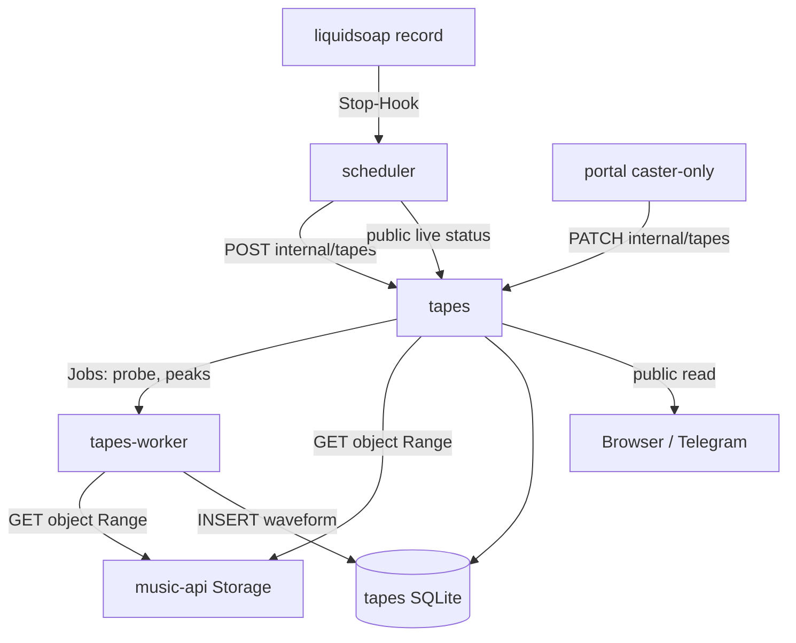

# Tapes

Öffentlicher, lesender Recordings-Feed von radio zukka: eine Rust-Service-Binary
(API + Waveform-Pipeline + Audio-Proxy) plus eine statische, framework-freie
Oberfläche in der etablierten radio-zukka-Optik (Kassetten-Look, Salbeigrün /
Creme / Türkis / Orange, Pixel- und Monospace-Typografie).

Referenz für dieses Dokument sind `README.md` und `docs/architecture.md`.
Insbesondere gilt: **Tape = Recording** (architecture §3), **Music API ist die
einzige Datei-Autorität** (architecture §6), **Zeit immer Europe/Berlin**
(architecture §9).

---

## 1. Scope

### In Scope

| Bereich              | Inhalt                                                                                    |
| -------------------- | ----------------------------------------------------------------------------------------- |
| Datenmodell          | `tape`, `waveform`, `tape_job`, `caster`-Projektion (SQLite)                              |
| Public API           | auth-frei, nur lesend: Feed, Detail, Caster-Liste, Waveform, Audio                        |
| Waveform-Pipeline    | ffprobe/ffmpeg → Peaks → BLOB, persistente Job-Queue, Retries                             |
| Audio-Auslieferung   | Range-Requests, CORS, Cache-Header, Download-Variante                                     |
| Share                | kanonische Slug-URL, OG-Meta, In-Page-Anchors                                             |
| UI                   | Feed, Caster-Filter, Waveform-Rendering, Bottom-Player, Share/Download                    |
| Deployment           | `tapes.dev.zukkafabrik.de`, systemd (web + worker), Caddy-Site                            |
| Interner Schreibpfad | loopback-only API, damit Recording-Registrierung und Portal-Edits das Tape pflegen können |

### Out of Scope

- Aufnahme selbst (liquidsoap) und Format-/Bitraten-Wahl der Aufnahme.
- Auth, Login, RBAC (Portal).
- Upload- und Library-Flow (Portal).
- Transcoding-Kette für browser-unfreundliche Formate (nur offener Punkt, §4).
- Tracklisten / Setlists / Kapitelmarken innerhalb eines Tapes.
- Announcements (Telegram) — Hook existiert, Versand ist Scheduler-Sache.
- Suche über Tape-Inhalte (nur später optionale Volltextsuche, §4).

### Abhängigkeiten

| Von       | Was tapes braucht                                                         | Art                          |
| --------- | ------------------------------------------------------------------------- | ---------------------------- |
| music-api | Objekt-Read mit Byte-Range, Metadaten (Größe, MIME)                       | HTTP, Server-Token           |
| scheduler | Recording-Registrierung (`POST` internal), Caster-Projektion, Live-Status | HTTP, Service-Token / public |
| portal    | Titel/Beschreibung/Sichtbarkeit (über internal API)                       | HTTP, Service-Token          |
| caddy     | TLS, statische Assets, Range-Passthrough                                  | Reverse Proxy                |

Tapes ist **nicht** abhängig vom Scheduler für Lese-Anfragen. Fällt der Scheduler
aus, bleibt der Feed vollständig funktionsfähig (nur der LIVE-Badge degradiert).

### Ist-Stand (2026-11-21, #132)

Der Scheduler besitzt den Ingest: Liquidsoap schreibt
`/recordings/<tape_id>.mp3`, ein Poll-Task im Scheduler hasht die Datei
streaming, dedupliziert per `HEAD /objects/{sha256}`, lädt sie sonst per
`PUT /objects/{sha256}` zur Music API, füllt `tapes` (music_api_id,
storage_key, size_bytes, etag, format='mp3', mime='audio/mpeg',
status='processing') und reiht `probe`/`peaks` in `tape_jobs` ein. Die
Staging-Datei wird erst nach erfolgreichem Commit gelöscht; Fehler lassen
Job (`failed`, retrybar) und Datei liegen. Der read-only tapes-worker claimt
weiterhin nur `probe`/`peaks` — `kind='upload'` ist an
`/internal/tape-jobs/claim` gesperrt (400) und per PATCH nicht änderbar (409).

---

## 2. Entscheidungen

| #       | Entscheidung                                                                                                                                                           | Begründung                                                                                                                    |
| ------- | ---------------------------------------------------------------------------------------------------------------------------------------------------------------------- | ----------------------------------------------------------------------------------------------------------------------------- |
| **D1**  | Tape = Recording = **ein** Datensatz mit `source = 'live' \| 'upload'`                                                                                                 | architecture §3; identische Auslieferung, identisches UI                                                                      |
| **D2**  | Öffentlicher Schlüssel ist der **Slug**, intern `id` (ULID)                                                                                                            | Slug ist stabil, lesbar, teilbar; ULIDs ordnen Registrierung                                                                  |
| **D3**  | Tapes ist **System of Record** für Tape-Metadaten + Waveform; Audio-Bytes bleiben ausschließlich bei music-api                                                         | Metadaten und Peaks sind abgeleitete, öffentliche Sicht; keine Datei-Kopie außerhalb der Autorität                            |
| **D4**  | Public API ist **strikt lesend, ohne Auth**; Schreiben nur über internen Loopback-Listener mit Bearer-Token                                                            | Keine Rechteprüfung im öffentlichen Pfad nötig; kein Leak von Schreibflächen via Caddy                                        |
| **D5**  | Zeitpunkte werden als **UTC-Instants** (Unix ms) gespeichert, Anzeige immer `Europe/Berlin` (chrono-tz serverseitig, `Intl` clientseitig)                              | DST-korrekt ohne Offset-Hardcoding; „immer Berlin" gilt für die Darstellung                                                   |
| **D6**  | `duration_ms` = **dekodierte** Dauer (ffprobe); `started_at`/`ended_at` = **Wanduhr**-Fenster                                                                          | Player/Seek braucht dekodierte Dauer; Sendefenster ist Wanduhr. Abweichung (Dropouts) ist erlaubt und wird nicht „korrigiert" |
| **D7**  | Ein Peak-Format: **500 ms pro Bar, 1 Byte pro Bar**, absoluter dBFS-Pegel; Client downsamplet auf Canvas-Breite                                                        | ~14 KB für ein 2-h-Tape, keine Level-Stufen, kein JSON-Parsing; Client kann jede Widget-Breite bedienen                       |
| **D8**  | Peaks als BLOB in **eigener Tabelle** `waveform` inkl. `scheme`-Version                                                                                                | Hält `tape`-Zeilen klein (Listen-Scans schnell); Schema-Änderung = neu berechenbar                                            |
| **D9**  | Audio über **Tapes-Proxy** `/media/{slug}.{ext}`, nicht per Redirect auf Pre-Signed-URLs                                                                               | Stabile, teilbare URLs; Range, CORS und Cache an genau einer Stelle; keine Token in Share-Links                               |
| **D10** | Range: nur **ein** Bereich; Multiple-Ranges → vollständige 200-Antwort                                                                                                 | Spec-konform; Client braucht nie Multi-Range; spart Parser                                                                    |
| **D11** | Audio-Inhalt ist **immutable**; neue Fassung = neuer Slug                                                                                                              | Erlaubt `immutable`-Caching und stabile ETags                                                                                 |
| **D12** | Sichtbarkeit über `visible` + `status`; unsichtbare Tapes → **404** (nie 403)                                                                                          | Kein Existenz-Leak; saubere Link-Previews                                                                                     |
| **D13** | `/t/{slug}` liefert **server-gerenderte** OG-/Twitter-Meta + 404 bei unbekanntem Slug                                                                                  | Telegram & Co. führen kein JS aus; Link-Preview ist Kernfunktion von „share"                                                  |
| **D14** | Kein Frontend-Framework, kein CDN, keine externen Font-Requests; Fonts self-hosted                                                                                     | Zero-Downtime-/Self-Hosting-Anspruch; Datenschutz; kein Fremdausfall                                                          |
| **D15** | Mechanik: `visible` default **0**; Veröffentlichen ist ein expliziter Schritt                                                                                          | Policy (auto vs. opt-in) bleibt offen (§4), Mechanik nicht                                                                    |
| **D16** | Pagination per **Keyset-Cursor** auf `(started_at DESC, slug DESC)`, kein Offset                                                                                       | Stabile Seiten bei laufend neuen Tapes                                                                                        |
| **D17** | `caster` ist eine **lokale Projektion** (Name, Akzent, Sortierung), per Worker aus dem Public-Endpoint gesynct; `tape` speichert zusätzlich `caster_name` als Snapshot | Feed-Rendering braucht keinen Cross-Service-Call; historische Namen bleiben korrekt                                           |
| **D18** | **Eine** Crate, **zwei** systemd-Units: `zukka-tapes-web`, `zukka-tapes-worker` (Subcommand `serve` / `work`)                                                          | Gleiches Schema, gleiche Waveform-Logik, getrennte Ressourcen-/Restart-Domänen                                                |

### Notizen zu den tragenden Entscheidungen

**D5 — „Berlin überall" heißt Darstellung, nicht Speicherung.** Ein Instant als
UTC zu speichern ist nicht dasselbe wie ein UTC-Offset hardzucoden: Es gibt
genau eine Repräsentation, die im Oktober/November eindeutig ist. Das JSON
liefert zusätzlich `start_local` **mit explizitem Offset** (`+01:00` / `+02:00`),
damit die doppelte Stunde (25.10.) auflösbar bleibt.

**D7 — Warum RMS statt Peak.** DJ-Sets sind komprimiert; Peak-Peaks pro Fenster
liegen fast durchgehend bei 1.0 und ergeben einen Ziegelstein. RMS in dBFS
zeigt leise Passagen und Breaks. Die Abbildung ist deshalb
`v = clamp(round(255 * (db + 60) / 60))` mit `db = 20*log10(rms)`; das
Rendering darf zusätzlich Gamma/Floor anwenden (rein clientseitig, kein
Datenmodell-Eingriff).

**D9 vs. Redirect.** Wenn music-api dauerhaft Byte-Range und CORS selbst
beherrscht, ist ein `302` auf Pre-Signed-URLs bandbreitenschonender. Das ist
ein bewusst offen gelassener Alternativpfad, kein Bestandteil von v1
(§4, §5 R2).

---

## 3. Schnittstellen

### 3.1 Begriffsklärung im Tape-Kontext

| Feld / Begriff | Bedeutung                                                                     |
| -------------- | ----------------------------------------------------------------------------- |
| Zeitfenster    | `started_at` – `ended_at`, Wanduhr des Recordings, in Berlin angezeigt        |
| Dauer          | `duration_ms`, dekodierte Audiolänge; maßgeblich für Seek und Progress        |
| Caster         | Portal-User mit Streamer-Credentials (architecture §3), hier nur Name/Akzent  |
| Show           | optionale Zuordnung (`show_id`), liefert Fallback-Titel                       |
| Status         | `pending` → `processing` → `ready` (oder `failed`) — Pipeline-Zustand         |
| Visible        | redaktionelle Freigabe; nur `visible = 1 AND status = 'ready'` ist öffentlich |
| Slug           | 8 Zeichen Crockford-Base32, kollisionsgeprüft, **unveränderlich**             |

### 3.2 Datenmodell (SQLite)

```sql
PRAGMA journal_mode = WAL;
PRAGMA foreign_keys = ON;

CREATE TABLE tape (
  id           TEXT PRIMARY KEY,             -- ULID, intern
  slug         TEXT NOT NULL UNIQUE,         -- öffentlicher Schlüssel
  caster_id    TEXT NOT NULL,
  caster_name  TEXT NOT NULL,                -- Snapshot zum Aufnahmezeitpunkt
  show_id      TEXT,
  show_name    TEXT,
  title        TEXT,                         -- NULL = Fallback-Logik greift (D17/§3.3)
  description  TEXT,
  started_at   INTEGER NOT NULL,             -- Unix ms UTC (Wanduhr)
  ended_at     INTEGER NOT NULL,             -- Unix ms UTC (Wanduhr)
  duration_ms  INTEGER,                      -- dekodiert, NULL bis ffprobe fertig
  source       TEXT NOT NULL,                -- 'live' | 'upload'
  object_key   TEXT NOT NULL UNIQUE,         -- music-api Objekt
  format       TEXT,                         -- 'mp3' | 'flac' | 'aac' | 'opus' | ...
  mime         TEXT,
  size_bytes   INTEGER,
  etag         TEXT,                         -- aus Objekt-Metadaten, für Range/304
  status       TEXT NOT NULL DEFAULT 'pending',
  visible      INTEGER NOT NULL DEFAULT 0,
  published_at INTEGER,                      -- gesetzt beim ersten visible=1
  created_at   INTEGER NOT NULL,
  updated_at   INTEGER NOT NULL,
  CHECK (status IN ('pending','processing','ready','failed','deleted')),
  CHECK (source IN ('live','upload')),
  CHECK (ended_at >= started_at)
);

CREATE INDEX tape_feed      ON tape(visible, status, started_at DESC, slug DESC);
CREATE INDEX tape_by_caster ON tape(caster_id, started_at DESC);
CREATE INDEX tape_due_pipe  ON tape(status, created_at);

CREATE TABLE waveform (
  tape_id      TEXT PRIMARY KEY REFERENCES tape(id) ON DELETE CASCADE,
  scheme       INTEGER NOT NULL,             -- Peak-Schema, v1 = 1
  algorithm    TEXT NOT NULL,                -- 'ffmpeg-rms-500ms/1'
  ms_per_bar   INTEGER NOT NULL,             -- 500
  bars         INTEGER NOT NULL,
  data         BLOB NOT NULL,                -- bars × u8
  created_at   INTEGER NOT NULL
);

CREATE TABLE tape_job (
  id         INTEGER PRIMARY KEY AUTOINCREMENT,
  tape_id    TEXT NOT NULL REFERENCES tape(id) ON DELETE CASCADE,
  kind       TEXT NOT NULL,                  -- 'probe' | 'peaks'
  state      TEXT NOT NULL DEFAULT 'queued', -- queued|running|done|failed
  attempts   INTEGER NOT NULL DEFAULT 0,
  run_after  INTEGER NOT NULL,
  last_error TEXT,
  updated_at INTEGER NOT NULL,
  UNIQUE (tape_id, kind)
);
CREATE INDEX tape_job_due ON tape_job(state, run_after);

CREATE TABLE caster (
  caster_id    TEXT PRIMARY KEY,
  display_name TEXT NOT NULL,
  accent       TEXT,                         -- UI-Akzent: sage|teal|orange|cream|grey
  sort_order   INTEGER NOT NULL DEFAULT 0,
  hidden       INTEGER NOT NULL DEFAULT 0,
  synced_at    INTEGER NOT NULL
);
```

`DELETE` ist immer ein Soft-Delete (`status = 'deleted'`), damit Slugs nicht
wieder frei werden und ein versehentliches Löschen rückholbar ist.

### 3.3 Das Tape-Objekt (JSON)

`GET /api/v1/tapes/{slug}`:

```json
{
  "slug": "8f3kq2m9",
  "caster": { "id": "momo", "name": "momo", "accent": "teal" },
  "show": { "id": "deep-cuts", "name": "Deep Cuts" },
  "title": null,
  "display_title": "momo – Deep Cuts",
  "description": null,
  "started_at": "2026-11-23T10:00:00Z",
  "ended_at": "2026-11-23T12:00:00Z",
  "start_local": "2026-11-23T11:00:00+01:00",
  "end_local": "2026-11-23T13:00:00+01:00",
  "tz": "Europe/Berlin",
  "window_label": "23.11.2026 11:00 – 13:00",
  "duration_ms": 7194000,
  "source": "live",
  "format": "mp3",
  "mime": "audio/mpeg",
  "size_bytes": 172829184,
  "audio_url": "https://tapes.dev.zukkafabrik.de/media/8f3kq2m9.mp3",
  "download_url": "https://tapes.dev.zukkafabrik.de/media/8f3kq2m9.mp3?download=1",
  "waveform_url": "https://tapes.dev.zukkafabrik.de/api/v1/tapes/8f3kq2m9/waveform",
  "peaks": { "scheme": 1, "ms_per_bar": 500, "bars": 14388 },
  "share_url": "https://tapes.dev.zukkafabrik.de/t/8f3kq2m9",
  "published_at": "2026-11-23T12:04:11Z",
  "updated_at": "2026-11-23T12:04:11Z"
}
```

Regeln:

- `title` ist roh (`null` wenn nie gesetzt); `display_title` enthält die
  serverseitige Fallback-Kette **manueller Titel > Show-Name > Caster-Name**
  (architecture §3, ohne die noch offenen Zeitregeln).
- `peaks` ist `null`, solange kein `waveform`-Datensatz existiert (Frontend
  zeichnet dann einen Platzhalter-Platten-Look und versucht es lazily erneut).
- `audio_url` / `waveform_url` / `share_url` sind **absolute** URLs aus
  `PUBLIC_BASE_URL`, damit Share-Texte und `<audio src>` ohne Bastelei stimmen.
- `status`, `visible`, `object_key`, `etag` werden **nie** öffentlich ausgegeben.

### 3.4 Public API (lesend, auth-frei)

| Methode      | Pfad                            | Zweck                                                                        | Cache                |
| ------------ | ------------------------------- | ---------------------------------------------------------------------------- | -------------------- |
| `GET`        | `/api/v1/healthz`               | Liveness + DB-Check                                                          | `no-store`           |
| `GET`        | `/api/v1/meta`                  | Stationsname, `tz`, `format_version`, Feature-Flags (z. B. `download: true`) | `max-age=300`        |
| `GET`        | `/api/v1/casters`               | Filterleiste: Caster + Tape-Zähler + letzter Upload                          | `max-age=60`         |
| `GET`        | `/api/v1/tapes`                 | Feed, gefiltert/paginiert                                                    | `max-age=60` + ETag  |
| `GET`        | `/api/v1/tapes/{slug}`          | Einzel-Tape                                                                  | `max-age=300` + ETag |
| `GET`        | `/api/v1/tapes/{slug}/waveform` | Peaks (binär)                                                                | `immutable`          |
| `GET`/`HEAD` | `/media/{slug}.{ext}`           | Audio, Range-fähig                                                           | `immutable`          |
| `GET`        | `/t/{slug}`                     | HTML mit OG-Meta + App-Shell                                                 | `max-age=60`         |
| `GET`        | `/`                             | App-Shell                                                                    | `max-age=60`         |
| `GET`        | `/robots.txt`, `/sitemap.xml`   | Crawling der `visible`-Tapes                                                 | `max-age=3600`       |

**`GET /api/v1/tapes`**

| Parameter | Typ                           | Default  | Semantik                                                |
| --------- | ----------------------------- | -------- | ------------------------------------------------------- |
| `caster`  | string, wiederholbar oder CSV | –        | Filter auf `caster_id`                                  |
| `from`    | `YYYY-MM-DD`                  | –        | `started_at >= 00:00 Berlin` des Tages                  |
| `to`      | `YYYY-MM-DD`                  | –        | `started_at < 00:00 Berlin` des Folgetags               |
| `q`       | string                        | –        | Substring auf `title`/`display_title` (v1 optional, §4) |
| `sort`    | `newest` \| `oldest`          | `newest` | Reihenfolge                                             |
| `limit`   | 1–200                         | 50       | Seitengröße                                             |
| `cursor`  | opaque                        | –        | Keyset-Cursor                                           |

`from`/`to` werden **als Berliner Kalendertage** interpretiert (via chrono-tz
auf Mitternacht Berlin abgebildet, DST-korrekt), nicht als UTC-Tage.

```json
{
  "tapes": [{ "slug": "8f3kq2m9", "…": "…" }],
  "next_cursor": "eyJ0IjoxNzYzODkwMDAwMDAwLCJzIjoiOGYza3EybTkifQ",
  "count": 50,
  "server_time": "2026-11-23T12:31:07Z"
}
```

`next_cursor` ist `base64url("{\"t\":<started_at_ms>,\"s\":\"<slug>\"}")`.

**`GET /api/v1/casters`**

```json
[
  {
    "id": "momo",
    "name": "momo",
    "accent": "teal",
    "tape_count": 12,
    "last_tape_at": "2026-11-23T10:00:00Z"
  },
  {
    "id": "duck",
    "name": "duck",
    "accent": "orange",
    "tape_count": 9,
    "last_tape_at": "2026-11-22T19:00:00Z"
  }
]
```

Sortierung: `sort_order`, dann `display_name`. Nur Caster mit
`tape_count > 0` und `hidden = 0`.

### 3.5 Fehler und Caching (Public)

Einheitliches Fehlerobjekt:

```json
{ "error": { "code": "not_found", "message": "tape not found" } }
```

| Status                      | Wann                                                | Zusatz                                                                |
| --------------------------- | --------------------------------------------------- | --------------------------------------------------------------------- |
| `404 not_found`             | Slug unbekannt, `deleted`, `visible = 0`            | Kein Unterschied zwischen „unbekannt" und „versteckt"                 |
| `409`/`503`                 | Tape existiert, `status != ready`                   | `error.code = "not_ready"`, `Retry-After: 30` (nur internal relevant) |
| `400 bad_request`           | ungültiger `cursor`, `from > to`, `limit` außerhalb | `error.code` spezifisch                                               |
| `416 range_not_satisfiable` | Range außerhalb der Datei                           | `Content-Range: bytes */{size}`                                       |
| `405 method_not_allowed`    | alles außer `GET`/`HEAD`/`OPTIONS`                  | `Allow: GET, HEAD, OPTIONS`                                           |
| `429`                       | Rate-Limit getroffen (`/media` pro IP)              | `Retry-After`                                                         |
| `502 upstream_unavailable`  | music-api-Fehler                                    | `error.code = "storage"`                                              |

ETags: hash aus `updated_at` + `slug` (Feed/Detail). `If-None-Match` → `304`
mit leeren Headern.

### 3.6 Waveform-Binärformat (`application/octet-stream`)

```
Offset  Size  Feld
0       4     magic = "ZKWV"
4       1     version = 1
5       1     flags (reserviert, 0)
6       2     reserved (0)
8       4     bars (u32 LE)
12      bars  Peak-Werte, 1 Byte pro Bar (0 = Stille, 255 = 0 dBFS)
```

- `Content-Type: application/octet-stream`, `Content-Length = 12 + bars`,
  `Cache-Control: public, max-age=31536000, immutable`,
  `ETag: "w1-<tape>-<bars>"`.
- Client liest Header, prüft `magic`/`version`, wirft sonst weg und zeichnet
  den Platzhalter. `scheme` aus dem Tape-JSON muss zu `version` passen, sonst
  Refetch mit `?v=<scheme>`.
- Downsampling im Client: Zielbreite `W` Pixel, `gruppen = ceil(bars / W)`,
  pro Gruppe **Maximum** (nicht Mittelwert — Mittelwert verschluckt Transienten).
- Bar-Grenzen folgen `ms_per_bar`; Zeit unter dem Cursor =
  `bar_index * ms_per_bar`.

### 3.7 Audio-Auslieferung

**Route:** `GET|HEAD /media/{slug}.{ext}` (`{ext}` ∈ `mp3|m4a|aac|ogg|opus|flac|wav`,
muss zu `tape.format` passen, sonst 404).

**Upstream:** `GET {MUSIC_API_URL}/objects/{object_key}` mit
`Authorization: Bearer $MUSIC_API_TOKEN`; der `Range`-Header des Clients wird
**durchgereicht**, die Antwort gestreamt (kein Buffering, keine Kompression).

**Antwort-Header (200):**

```
Accept-Ranges: bytes
Content-Type: <tape.mime>
Content-Length: <tape.size_bytes>
ETag: "<tape.etag>"
Cache-Control: public, max-age=31536000, immutable
Access-Control-Allow-Origin: *
Access-Control-Expose-Headers: Content-Length, Content-Range, Accept-Ranges, ETag
```

**Range-Verhalten:**

| Client                          | Antwort                                                             |
| ------------------------------- | ------------------------------------------------------------------- |
| `Range: bytes=0-1023`           | `206`, `Content-Range: bytes 0-1023/{size}`, `Content-Length: 1024` |
| `Range: bytes=1000-`            | `206` bis Dateiende                                                 |
| `Range: bytes=-4096`            | `206`, letzte 4096 Bytes                                            |
| `Range: bytes=0-1023,2000-3023` | `200`, volle Datei (D10)                                            |
| `Range: bytes={size}-`          | `416` + `Content-Range: bytes */{size}`                             |
| `Range: items=0-1`              | ignoriert → `200`                                                   |
| `If-Range: "<etag>"` + `Range`  | `206` (ETag passt) / `200` (passt nicht)                            |
| `If-None-Match: "<etag>"`       | `304`                                                               |

- `?download=1` setzt `Content-Disposition: attachment; filename="{caster}-{YYYY-MM-DD}-{HHMM}.mp3"`
  (Berliner Zeit im Dateinamen) und `Cache-Control: private, no-transform`.
- `HEAD` liefert dieselben Header ohne Body.
- Upstream-Fehler → `502` + `Retry-After: 5`; Upstream-`416` wird zu `416`
  mit eigener `Content-Range` normalisiert.
- **CORS** gilt für alle Public-Routen: `OPTIONS` → `204` mit
  `Access-Control-Allow-Methods: GET, HEAD, OPTIONS`,
  `Access-Control-Max-Age: 86400`; niemals `Allow-Credentials` (keine Cookies,
  keine Auth — `*` ist hier korrekt).

**Caddy-Site** (Ausschnitt, Details in `infrastructure.md`):

```
tapes.dev.zukkafabrik.de {
    encode zstd gzip
    @media path /media/*
    reverse_proxy /media/* 127.0.0.1:8085 {
        flush_interval -1
        # kein gzip/zstd für Audio: encode-Block gilt nur für Text-Handler
    }
    reverse_proxy /api/* 127.0.0.1:8085
    reverse_proxy /t/* 127.0.0.1:8085
    root * /srv/tapes/assets
    file_server
    header {
        Strict-Transport-Security "max-age=31536000; includeSubDomains"
        X-Content-Type-Options "nosniff"
        Referrer-Policy "strict-origin-when-cross-origin"
    }
}
```

Audio wird **nicht** komprimiert: `encode` wird per `@media not path /media/*`
gescoped. `flush_interval -1` verhindert, dass gestreamte 206-Antworten
gepuffert werden.

### 3.8 Internal API (Schreibpfad, loopback-only)

Eigener Listener `TAPES_INTERNAL_BIND=127.0.0.1:8086`, **nicht** über Caddy
erreichbar, `Authorization: Bearer $TAPES_INTERNAL_TOKEN` auf jeder Route.

| Methode  | Pfad                               | Zweck                                                                               |
| -------- | ---------------------------------- | ----------------------------------------------------------------------------------- |
| `POST`   | `/internal/tapes`                  | Recording registrieren (idempotent über `object_key`)                               |
| `PATCH`  | `/internal/tapes/{slug}`           | `title`, `description`, `show_id`, `caster_id`, `visible`, `started_at`, `ended_at` |
| `POST`   | `/internal/tapes/{slug}/reprocess` | Peaks neu berechnen (nach `algorithm`-Wechsel)                                      |
| `DELETE` | `/internal/tapes/{slug}`           | Soft-Delete                                                                         |
| `POST`   | `/internal/casters/sync`           | Caster-Projektion manuell aktualisieren                                             |

`POST /internal/tapes` Beispiel:

```json
{
  "object_key": "recordings/momo/2026-11-23T10-00Z.mp3",
  "caster_id": "momo",
  "show_id": "deep-cuts",
  "started_at": "2026-11-23T10:00:00Z",
  "ended_at": "2026-11-23T12:00:00Z",
  "source": "live",
  "format": "mp3"
}
```

Antwort: das Tape-Objekt (§3.3). Bei existierendem `object_key` → `200` mit dem
bestehenden Tape (Idempotenz, kein Duplikat nach Retry des Schedulers).
Nach dem Insert enqueued der Service `probe` + `peaks` in `tape_job`;
`visible` bleibt `0` (D15).

Wichtig: Das ist der **einzige** Weg, auf dem neue Tapes entstehen. Der Worker
liest `tape_job`, nicht die HTTP-Schicht — Web und Worker teilen nur die DB.

### 3.9 Share-Links und Anchors

| Form                                                       | Verhalten                                                                                                                                                      |
| ---------------------------------------------------------- | -------------------------------------------------------------------------------------------------------------------------------------------------------------- |
| `https://tapes.dev.zukkafabrik.de/t/8f3kq2m9`              | **kanonisch**. Server rendert Shell mit per-Tape-OG-Meta, Client öffnet den Feed auf dem Tape, scrollt hin, hebt hervor, legt es in den Player (ohne Autoplay) |
| `https://tapes.dev.zukkafabrik.de/#t-8f3kq2m9`             | In-Page-Anchor: scrollt/hervorhebt im aktuellen Feed, Filter wird bei Bedarf auf `ALL` zurückgesetzt                                                           |
| `https://tapes.dev.zukkafabrik.de/?caster=momo#t-8f3kq2m9` | gefilterter Feed mit Anchor (deep link in eine Caster-Ansicht)                                                                                                 |

- Der **[LINK]**-Button kopiert immer die **kanonische** `/t/`-URL
  (`navigator.clipboard.writeText`, Fallback: `document.execCommand('copy')` mit
  temporärem Textfeld), nicht die Hash-Variante.
- Server-seitig injizierte Meta für `/t/{slug}`:

```html
<title>momo – 23.11.2026 11:00–13:00 // radio zukka tapes</title>
<meta property="og:type" content="article" />
<meta property="og:title" content="momo – 23.11.2026 11:00–13:00" />
<meta property="og:description" content="Deep Cuts · 1:59:54" />
<meta property="og:url" content="https://tapes.dev.zukkafabrik.de/t/8f3kq2m9" />
<meta property="og:audio" content="https://tapes.dev.zukkafabrik.de/media/8f3kq2m9.mp3" />
<meta property="og:audio:type" content="audio/mpeg" />
<meta
  property="og:image"
  content="https://tapes.dev.zukkafabrik.de/t/8f3kq2m9/card.png"
/>
<meta name="twitter:card" content="summary_large_image" />
<link rel="canonical" href="https://tapes.dev.zukkafabrik.de/t/8f3kq2m9" />
```

- Unbekannter/unsichtbarer Slug → echte `404`-Seite (kein SPA-Fallback),
  damit Crawler und Chat-Previews korrekt reagieren.
- `window.__TAPE__ = {…}` im Shell-HTML erspart dem Client einen Roundtrip für
  das angesprungene Tape.

### 3.10 UI-Struktur

**Auslieferung:** Shell + Meta kommen aus der Binary (`include_str!` +
String-Injection), JS/CSS/Fonts sind statisch (`/assets/*`, `immutable`).

```
tapes/
  src/
    main.rs            # clap: serve | work
    config.rs          # Env-Parsing, PUBLIC_BASE_URL, Pfade
    api/mod.rs         # Public-Router
    api/internal.rs    # interner Router (Bearer)
    db.rs              # Migrationen, Queries (keyset, feed)
    model.rs           # Tape, Caster, Fehlerobjekte, JSON-Serialisierung
    slug.rs            # Crockford-Base32, Kollisionsprüfung
    timefmt.rs         # chrono-tz, window_label, Dateinamen
    media.rs           # Range-Parser, Proxy-Streaming, CORS
    waveform.rs        # ffprobe/ffmpeg, Peak-Berechnung, BLOB-Format
    worker.rs          # Job-Loop, Retry/Backoff, caster-sync
    shell.rs           # HTML-Injection, OG-Meta, 404-Seite
    card.rs            # (optional) og:image PNG
  assets/
    index.html         # Shell-Vorlage (Platzhalter für Meta/__TAPE__)
    app.css            # Retro-Optik
    app.mjs            # Bootstrap: State, URL-Sync, Feed-Rendering
    peaks.mjs          # Fetch/Decode/Downsample, Canvas-Zeichnung
    player.mjs         # HTMLAudioElement, Transport, Progress
    fonts/             # VT323.woff2, SpaceMono-Regular.woff2, SpaceMono-Bold.woff2
  tests/
```

**Layout (Desktop/Mobil identisch strukturiert):**

1. **Header** (Bevel-Box, Creme): Farbquadrat in Zukka-Orange, `radio zukka`,
   Pfad `/ tapes`, rechts `◀ LIVE` (verlinkt auf den Stream-Host; aus
   `/api/v1/meta` bzw. dem Scheduler-Live-Endpoint, §4 F8) und `PORTAL`.
2. **Filterleiste**: `[ ALL ] [ momo ] [ duck ] [ ANKD ] …` als
   Retro-Drucktasten; aktiver Tab „eingedrückt"; rechts Tape-Zähler des
   Filters. Tabs kommen aus `/api/v1/casters`, `ALL` ist Default.
3. **Feed**: Karten in der Kassetten-Optik (Creme, Bevel, 2 px harter
   Schatten), pro Tape:
   - Transport-Button (▶ / ❚❚), Caster-Name (klickbar → Filter), Zeitfenster
     (`23.11.2026 11:00 – 13:00`), Dauer (`1:59:54`, Pixel-Font), `[LINK]`,
     `⬇ MP3`;
   - Waveform-Canvas (eingesenkter Rahmen, gespiegelte Balken, gespielter Teil
     Orange, Hover-Bereich Türkis, Rest Grau), Overlay-Badges für
     `00:00` / Hover-Zeit / Gesamtdauer;
   - Platzhalter-Balkenmuster, solange keine Peaks geladen sind.
4. **Bottom-Player** (fixed, `padding-bottom: env(safe-area-inset-bottom)`):
   `|<  ▶/❚❚  ■  >|`, LCD-Feld mit `caster // Zeitfenster` links und
   `aktuell / gesamt` rechts, 2 px hohe Fortschrittsleiste (klickbar), Volume
   (≥ `sm`).
5. **Toast** oben rechts für „Link kopiert" / „Download gestartet".

**Verhalten:**

- `<audio preload="none">` auf `audio_url` (same-origin → kein CORS-Problem,
  Range native). `seeking`/`timeupdate` + `requestAnimationFrame` für flüssige
  Waveform-Aktualisierung.
- Klick/`Enter` auf Waveform → `audio.currentTime = ratio * duration`;
  Klick auf fremde Karte lädt dieses Tape in den Player und startet.
- Ende → automatisch nächstes Tape **im aktuellen Filter** (Wrap-around).
  `|<`/`>|` respektieren den Filter ebenfalls.
- Filterwechsel bricht die Wiedergabe **nicht** ab (das laufende Tape bleibt
  im Player, auch wenn es nicht mehr im Feed sichtbar ist).
- URL-State: `?caster=` wird per `history.replaceState` gespiegelt, damit die
  gefilterte Ansicht teilbar ist.
- Lazy: Peaks und Canvas-Zeichnung erst ab `IntersectionObserver`-Eintritt;
  Peak-Arrays in einer `Map<slug, Uint8Array>` sessionweit gecacht.
- Kein Autoplay (Browser-Policy) — `/t/{slug}` lädt bereit, startet nicht.
- `prefers-reduced-motion`: keine Transitions/Blink-Effekte; Tastaturbedienung
  vollständig (`Tab`, `Space`, `Enter`), `aria-live` für den Player-Titel.
- `<noscript>`-Block: serverseitig gerenderte Liste der letzten 50 Tapes als
  Links (Crawler + kaputtes JS).

**Visuelle Referenz:** Die etablierte radio-zukka-Sprache (Salbeigrün-Hintergrund
mit Punktkorn, Kassetten-Creme mit 2000er-Bevel, Kassettentürkis, Plakat-Orange,
`VT323` für LCD/Pixel-Labels, `Space Mono` für Text, gespiegelte Balken-Waveform,
eingedrückte Drucktasten) ist der Stil-Rahmen. Sie wird als handgeschriebenes CSS
mit Tokens umgesetzt:

```css
:root {
  --sage: #9eb092; /* Hintergrund */
  --cream: #f2efe4; /* Kassette */
  --teal: #2a8fa8; /* Label / Hover / Aktiv */
  --orange: #e85a2a; /* Akzent / gespielt */
  --ink: #1a1a18;
  --bevel-light: #ffffff;
  --bevel-dark: #7a7770;
  --bevel-darker: #3d3b38;
  --btn: #d4d0c8;
  --lcd-bg: #161c1a;
  --lcd-fg: #7ee8fa;
}
```

Bevel-Regel als Utility (`.bevel`, `.bevel-inset`, `.key`) statt Copy-Paste pro
Komponente. Kontrast: Text auf Salbeigrün/Creme ≥ 4.5:1 (`--ink` auf `--sage`
und `--cream` erfüllt das; Orange nur für Flächen und gespielte Balken, nicht
für Fließtext).

### 3.11 Verhältnis Tapes ↔ Portal



|              | Tapes                                       | Portal                                                          |
| ------------ | ------------------------------------------- | --------------------------------------------------------------- |
| Zielgruppe   | alle, anonym                                | Caster (Auth)                                                   |
| Schreibrecht | keins                                       | ja, über internal API                                           |
| Sichtbarkeit | `visible = 1` **und** `status = 'ready'`    | sieht auch `pending`/`failed`/`visible = 0`                     |
| Rolle        | öffentliche Projektion + Auslieferung       | Autorität fürs Kuratieren (Titel, Beschreibung, Publish-Toggle) |
| Inhalt       | Zeitfenster, Caster, Dauer, Waveform, Audio | Library, Queue, Schedule, Tapes-Verwaltung                      |

Konsequenz: Das Portal braucht für die Tapes-Verwaltung keine eigene
Tape-Tabelle; es liest und schreibt über die internal API. Der Scheduler
registriert nur, er besitzt keine Metadaten-Hoheit nach der Registrierung.

---

## 4. Offene Fragen

| #       | Frage                                                                                                            | Auswirkung                                                   | Vorschlag / Klärung bis                                                                      |
| ------- | ---------------------------------------------------------------------------------------------------------------- | ------------------------------------------------------------ | -------------------------------------------------------------------------------------------- |
| **F1**  | Publish-Policy: Wird jedes Live-Recording automatisch öffentlich, oder ist `visible` opt-in durch den Caster?    | Rechtliches (Stimmen, Fremdmusik), Moderationsaufwand        | Mechanik ist opt-in (D15); Policy bis M3 klären, ggf. `AUTO_PUBLISH_CASTER`-Flag in `caster` |
| **F2**  | Wer ist Autorität für Caster-Name/Anzeige (Scheduler, Portal, music-hub)?                                        | `caster`-Projektion, Sync-Endpoint                           | Bis M2: Scheduler-Public-Endpoint; Alternative music-hub                                     |
| **F3**  | Aufnahmeformat/Bitrate der Live-Recordings (mp3? flac? 192k?)                                                    | `format`/`mime`, Transcoding-Bedarf, Dateigrößen             | `liquidsoap.md`; bis dahin `mp3` annehmen                                                    |
| **F4**  | Unterstützt music-api Byte-Range-Reads und liefert es `ETag`/`Content-Length`?                                   | Proxy-Implementierung, Range-Tests, `If-Range`               | Spike in M1 (echter `curl -r 0-99`)                                                          |
| **F5**  | Browser-unfreundliche Formate (flac/wav) — Transcode-Job oder Download-only?                                     | Pipeline-Umfang, Speicherbedarf                              | v1: Download-only, Playback nur bei mp3/aac/opus/ogg                                         |
| **F6**  | Takedown / Retention: Skript für „Tape offline" (nur `visible`/`deleted`) — gibt es Aufbewahrungspflichten?      | Datenmodell (Soft-Delete), Admin-Flow                        | Soft-Delete deckt v1; Policy offen                                                           |
| **F7**  | Wann darf `ended_at` von `started_at` abweichen (Dropouts, Pausen)? Anzeige der Wanduhr-Dauer vs. `duration_ms`? | Karten-Labels, Verwirrung bei 2:00 h Fenster / 1:59:54 Audio | `window_label` = Wanduhr, Dauer = `duration_ms` (D6); im UI klar getrennt                    |
| **F8**  | Contract für den LIVE-Badge (Scheduler-Public-Endpoint?)                                                         | Header, Sichtbarkeit „wer ist live"                          | Braucht `GET /api/public/live` → `{caster_id, since}` ohne Auth                              |
| **F9**  | Slug-Policy: rein zufällig (40 bit) oder vanity (`momo-2026-11-23`)?                                             | Kollisionen, Lesbarkeit, Brute-Force                         | v1 zufällig; Vanity als späteres `PATCH` (Slug-Wechsel nur mit Redirect-Map, §5 R7)          |
| **F10** | Wird eine Setlist/Trackliste pro Tape gebraucht (Kapitelmarken, Zoom)?                                           | Peak-Auflösung (500 ms reicht dann evtl. nicht), Datenmodell | Nicht in v1; `algorithm`-Feld erlaubt zweite Auflösung später                                |
| **F11** | Gibt es Play-Zähler/Statistiken (öffentlich sichtbar)?                                                           | Datenmodell, Privacy, Schreibpfad im Public-Pfad             | v1: nein                                                                                     |
| **F12** | Soll `og:image` (`/t/{slug}/card.png`) in v1 generiert werden?                                                   | Zusatzarbeit, Telegram-Vorschau-Qualität                     | v1.1; bis dahin statisches Fallback-Bild                                                     |
| **F13** | Domain-Konvention: gibt es zusätzlich `tapes.zukkafabrik.de` (prod)?                                             | `PUBLIC_BASE_URL`, Caddy, Meta                               | `tapes.dev.…` ist gesetzt; prod-Host bestätigen                                              |
| **F14** | Telegram-Announcement „Recording veröffentlicht" — Scheduler-Hook oder Tapes-Webhook?                            | Kopplung, Versandverantwortung                               | Scheduler (architecture §7); Tapes setzt nur `published_at` und liefert die Share-URL zurück |
| **F15** | Font-Lizenz: sind `VT323` und `Space Mono` (OFL) self-hosted OK, inkl. Lizenzdatei?                              | UI-Auslieferung                                              | OFL erlaubt Self-Hosting, `LICENSE`-Datei unter `assets/fonts/` ablegen                      |

---

## 5. Risiken

| #       | Risiko                                                                                    | Wirkung                                          | Gegenmaßnahme                                                                                                                                                                    |
| ------- | ----------------------------------------------------------------------------------------- | ------------------------------------------------ | -------------------------------------------------------------------------------------------------------------------------------------------------------------------------------- |
| **R1**  | `ffmpeg`-Peak-Berechnung über 2–3-h-Sets ist CPU-intensiv und hält Dateien im Speicher    | Worker-OOM, Verzögerung um Stunden               | Streaming-Decode (`-f s16le` in 64k-Chunks), nie ganze Datei puffern; ein Worker-Kind = ein Tape; `nice`/CPU-Quota; `attempts`-Cap mit `failed`                                  |
| **R2**  | Bandbreite über den Proxy (2-h-192k-mp3 ≈ 170 MB pro Hörer)                               | Hosting-Kosten, langsame Auslieferung            | `immutable`-Caching + Caddy-`file_server`-Cache-Proxy vor music-api (M6-optional); Alternative Pre-Signed-Redirect (D9-Alternative) bereithalten; Rate-Limit pro IP auf `/media` |
| **R3**  | music-api liefert kein `Content-Length`/`ETag` oder bricht bei Range                      | `416`-Logik, `If-Range`, Seek                    | F4-Spike in M1 **vor** UI-Bau; Fallback: `size_bytes`/`etag` aus `tape`, Range lokal aus Upstream-Stream rekonstruieren                                                          |
| **R4**  | SQLite-Contention zwischen Web und Worker (WAL, Schreibsperren)                           | Feed-Latenz-Spikes während Peak-Schreibvorgängen | Peaks als **eine** BLOB-Transaktion pro Tape; `busy_timeout`; Worker schreibt in kleinen Batches; Listen-Queries berühren `waveform` nie                                         |
| **R5**  | DST-Mehrdeutigkeit (25.10.2026 02:00–03:00 existiert zweimal)                             | Falsche Labels, „falsche" Sortierung             | UTC-Instants + `+01:00`/`+02:00` im JSON (D5); Tests mit dem DST-Tag in `timefmt`                                                                                                |
| **R6**  | Chat-Preview-Bots führen kein JS aus; SPA-Fehlerseiten brechen Links                      | Share-Links wirken kaputt                        | Echtes Server-404 (D13), OG-Meta servergerendert, `<noscript>`-Liste                                                                                                             |
| **R7**  | Slug wird später geändert (Vanity) → tote geteilte Links                                  | Link-Rot in Telegram                             | Slug in v1 unveränderlich (D2); Änderung nur via `tape_alias`-Tabelle + `301` (nicht in v1)                                                                                      |
| **R8**  | Großer Feed (hunderte Karten) mit Canvas pro Karte                                        | Ruckeln auf Mobilgeräten                         | IntersectionObserver, Canvas nur bei Sichtbarkeit zerstören/neu zeichnen, `limit=50` + „mehr laden"                                                                              |
| **R9**  | Versteckte Tapes leaken über Nebenwege (Waveform-Endpoint, Sitemap, Zähler in `/casters`) | Datenschutz (unveröffentlichte Aufnahme)         | Ein zentraler `public_tape(slug)`-Guard für **alle** Public-Routen; Counter-Queries filtern `visible/status`; Test dafür                                                         |
| **R10** | Uhrzeit-Drift zwischen Recording-Start und Broadcast-Slot                                 | Zeitfenster „falsch"                             | Scheduler setzt `started_at` aus dem tatsächlichen Record-Start, nicht aus dem Slot; Wanduhr-only (D6)                                                                           |
| **R11** | `crossorigin`/CORS-Fehler bei externen Einbettungen (späteres `/embed/`)                  | Player verstummt in fremdem Kontext              | Same-Origin-Design für v1; CORS-Header schon jetzt gesetzt; `/embed/` erst nach CORS-Test                                                                                        |

---

## 6. Umsetzungsschritte

Jeder Schritt ist einzeln deploybar; nach jedem Schritt ist `healthz` grün und
der Feed bleibt erreichbar.

**M0 — Contract-Freeze (0,5 d)**

1. Dieses Dokument als API-Freeze markieren (JSON-Beispiele, Fehlercodes,
   Binärformat, Range-Matrix).
2. Crate `tapes/` mit `serve`/`work`-Subcommands, `config.rs`, leerem Router,
   `/api/v1/healthz`.
3. CI: `cargo fmt --check`, `cargo clippy -D warnings`, `cargo test`.

**M1 — Datenmodell + Storage-Spike (1 d)** 4. Migrationen (§3.2), `db.rs` mit Keyset-Query und Feed-Index. 5. `slug.rs` (Crockford-Base32, 8 Zeichen, Unique-Retry). 6. `timefmt.rs` inkl. DST-Tests (25.10.2026, 29.03.2026). 7. Spike: echter Range-/`ETag`-Read gegen music-api dokumentieren (F4) —
Ergebnis entscheidet über `media.rs`-Design.

**M2 — Public API (1 d)** 8. `GET /api/v1/tapes` (Filter, Keyset, `limit`), `…/{slug}`, `/casters`,
`/meta`, ETag/`304`. 9. Zentraler `public_tape()`-Guard + Tests: `visible=0` → 404 auf **allen**
Routen (R9). 10. Fixture-Seeder (`cargo run --bin tapes -- seed-fixtures`) mit ~20 Tapes
ohne Audio, damit UI parallel starten kann (Peaks als Zufalls-BLOB im
Test-Schema erlaubt).

**M3 — Waveform-Pipeline (2 d)** 11. `waveform.rs`: `ffprobe` → `duration_ms`/`format`; `ffmpeg -i … -ac 1 -ar 8000
    -f s16le -` → 500-ms-Fenster (kein Hop), RMS in dBFS, Byte-Mapping;
Streaming, kein Vollpuffer (R1). 12. `worker.rs`: Job-Loop (`probe` → `peaks`), Retry mit exponentiellem Backoff
(`run_after`), `attempts`-Cap, `status`-Übergänge, Logging pro Tape. 13. `GET /api/v1/tapes/{slug}/waveform` + Cache-/ETag-Header. 14. `POST /internal/tapes` (idempotent über `object_key`) + `PATCH` + `reprocess` + `DELETE`; Bearer-Auth-Test.

**M4 — Audio-Auslieferung (1,5 d)** 15. `media.rs`: Range-Parser (Single-Range, Suffix, offen, 416, ignorierte
Units), Upstream-Streaming, `If-Range`, `If-None-Match`, `HEAD`,
`?download=1`, CORS-Preflight. 16. Integrationstests gegen einen Fixture-Objekt-Server (lokaler HTTP-Server,
der `Range` korrekt beantwortet) — 200/206/304/416/405-Matrix. 17. Caddy-Site + `flush_interval -1`, Encode-Scoping, Security-Header.

**M5 — UI (2–2,5 d)** 18. `index.html`-Shell + `shell.rs`-Injection (Meta, `__TAPE__`, 404-Seite,
`<noscript>`). 19. `app.css` mit Tokens/Bevel-Utilities, self-hosted Fonts + `LICENSE`. 20. `app.mjs`: State, Feed-Rendering, Caster-Tabs, `?caster=`-URL-Sync,
Anchor-Handling (`#t-`), Toast, `[LINK]`-Copy, „mehr laden". 21. `peaks.mjs`: Binär-Decode, Header-Validierung, Downsample (Max),
Canvas-Zeichnung (DPR, gespiegelt, Progress/Hover), Resize-Handling. 22. `player.mjs`: `HTMLAudioElement`, Transport, Seek aus Waveform und
Fortschrittsleiste, Auto-Next im Filter, Volume, `aria-live`. 23. A11y-Pass: Tastatur, Fokusringe, Kontrast ≥ 4.5, `prefers-reduced-motion`.

**M6 — Share, SEO, Deployment (1 d)** 24. OG-/Twitter-Meta, `canonical`, `robots.txt`, `sitemap.xml`,
`/t/{slug}/card.png` (optional, F12). 25. systemd: `zukka-tapes-web.service` (`serve`), `zukka-tapes-worker.service`
(`work`), `Restart=on-failure`, Resource-Limits für den Worker,
Env-File `/etc/zukka/tapes.env`. 26. Deploy auf `tapes.dev.zukkafabrik.de` (Caddy-Site, TLS, HSTS),
Backup des DB-Files (WAL-sicher via `sqlite3 .backup`). 27. Monitoring: `healthz`-Check, Job-Rückstand (`COUNT(*) WHERE state='queued'`),
Alarm bei `failed > 0` oder `queued`-Alter > 30 min.

**M7 — Integration (1 d)** 28. Scheduler-Hook: Recording-Stop → `POST /internal/tapes`; `published_at` +
Share-URL zurück für das Announcement (F14). 29. Portal: Tapes-Liste (auch nicht-öffentliche) + `PATCH`-Formular für
Titel/Beschreibung/`visible`. 30. Caster-Sync-Job aus dem Scheduler-Public-Endpoint (F2).

**Reihenfolge-Abhängigkeiten:** M1 → M2; M0 → M3; M3+M4 → M5 (UI braucht
echte Peaks **und** seekbares Audio); M5 → M6 → M7.

---

## 7. Akzeptanzkriterien

**API**

1. `GET /api/v1/tapes?limit=2` liefert `200`, `tapes` mit genau 2 Einträgen und
   `next_cursor`; der Call mit diesem `cursor` liefert **keine** Überschneidung
   mit der ersten Seite.
2. `GET /api/v1/tapes?caster=momo&from=2026-11-01&to=2026-11-30` enthält nur
   Tapes von `momo` mit `started_at` im Berliner November `2026`.
3. `GET /api/v1/tapes/{slug}` eines `visible=0`-Tapes → `404`
   `{"error":{"code":"not_found"}}`; identische Antwort für einen nie
   existierenden Slug (kein Existenz-Unterschied).
4. `GET /api/v1/tapes/{slug}` liefert `start_local` mit explizitem Offset und
   `window_label` in Berliner Zeit; ein Tape am `2026-10-25T00:30:00Z` zeigt
   `01:30` **mit** `+02:00`, ein Tape am `2026-10-25T01:30:00Z` zeigt `02:30`
   mit `+01:00`.
5. Zwei `GET`-Aufrufe auf `/api/v1/tapes/{slug}` mit `If-None-Match: <ETag>`
   ergeben beim zweiten `304` ohne Body.

**Waveform**

6. `GET /api/v1/tapes/{slug}/waveform` → `200`,
   `Content-Length == 12 + peaks.bars`, Magic `ZKWV`, Version `1`; für ein
   Tape mit `duration_ms = 7194000` gilt `bars == 14388` (500 ms/Bar, aufgerundet).
7. Für ein 5-Sekunden-Stille-Tape sind **alle** Peak-Bytes `0`; für ein
   Vollausschlag-Tape nahe `255` (Fixture-Test).
8. Ein `POST /internal/tapes` setzt `status=pending`; nach Worker-Lauf ist
   `status=ready`, `duration_ms` gesetzt und ein `waveform`-Datensatz
   vorhanden — ohne manuellen Eingriff.
9. Ein absichtlich fehlschlagender Decode (korrupte Fixture) endet nach
   `attempts`-Cap in `status=failed` mit gesetztem `last_error`, und der
   Service bleibt gesund (`healthz` grün).

**Audio**

10. `curl -sD- -o /dev/null -H 'Range: bytes=0-1023' https://tapes.dev.zukkafabrik.de/media/{slug}.mp3`
    → `206`, `Content-Range: bytes 0-1023/{size}`, `Content-Length: 1024`,
    `Accept-Ranges: bytes`.
11. `Range: bytes=-4096` → `206` mit `Content-Length: 4096`; `Range: bytes={size}-`
    → `416` mit `Content-Range: bytes */{size}`;
    `Range: bytes=0-99,200-299` → `200` (volle Datei).
12. `OPTIONS /media/{slug}.mp3` → `204` mit
    `Access-Control-Allow-Origin: *` und
    `Access-Control-Allow-Methods: GET, HEAD, OPTIONS`; jede `200`/`206`-Antwort
    trägt `Access-Control-Allow-Origin: *` und
    `Access-Control-Expose-Headers: Content-Range, Accept-Ranges, Content-Length, ETag`.
13. `?download=1` → `Content-Disposition: attachment; filename="momo-2026-11-23-1100.mp3"`.
14. Audio-Antworten sind **nicht** komprimiert (`Content-Encoding` fehlt) und
    laufen mit `flush_interval -1` durch Caddy (kein Full-Buffer bei Seek).

**Sichtbarkeit / Sicherheit**

15. Der interne Router ist von außen nicht erreichbar
    (`curl https://tapes.dev.zukkafabrik.de/internal/tapes -X POST` → `404`),
    und ein `POST` ohne Token auf `127.0.0.1:8086` → `401`.
16. `POST`/`PUT`/`DELETE` auf Public-Routen → `405` mit `Allow: GET, HEAD, OPTIONS`.
17. `/sitemap.xml` und `/api/v1/casters` enthalten keine unsichtbaren Tapes bzw.
    keine Caster, deren einzige Tapes unsichtbar sind.

**UI**

18. Ein `GET /t/{slug}` im HTML-Quelltext enthält `og:title`, `og:url`,
    `og:audio` und `twitter:card` mit den korrekten Werten des Tapes, auch ohne
    JS-Ausführung.
19. `GET /t/{unbekannt}` → HTTP `404` mit lesbarer Fehlerseite.
20. Klick auf einen Waveform-Punkt bei 50 % setzt `audio.currentTime` auf
    `duration/2` (± 1 s), und die Wiedergabe läuft ab dort weiter.
21. Caster-Tab `momo` filtert den Feed auf `momo`, setzt `?caster=momo` in der
    URL und übersteht einen Reload; `[LINK]` kopiert immer die `/t/{slug}`-Form.
22. `#t-{slug}` auf der Startseite scrollt zur Karte, hebt sie hervor und legt
    sie im Player bereit — **ohne** Autoplay.
23. Bei aktivem Filter und Tape-Ende springt der Player auf das nächste Tape
    **dieses** Filters (Wrap-around), nicht auf ein Tape aus `ALL`.
24. Vollständige Bedienung ohne Maus: `Tab` erreicht jede Karte, `Space`/`Enter`
    startet/stoppt, Waveform-Seek per Pfeiltasten (± 10 s) möglich.
25. Die Seite lädt ohne **einen einzigen** Request an eine fremde Domain
    (Fonts, JS, CSS, Bilder alle same-origin).
26. Lighthouse (mobil, throttled): Performance ≥ 80, Accessibility ≥ 95,
    „no third-party" im Network-Panel bestätigt.

**Betrieb**

27. `systemctl restart zukka-tapes-web` unter laufender Wiedergabe: neuer
    Seitenaufruf liefert `200`, laufendes `<audio>` bricht nicht ab, weil Range
    am Caddy-Cache/Upstream bedient wird (oder dokumentierter Fallback).
28. Nach `zustand: [Restart=on-failure]` einer abgebrochenen Peak-Berechnung
    wird der Job beim nächsten Worker-Start wieder aufgenommen (`state=running` →
    `queued`) und das Tape wird `ready`, ohne dass doppelte `waveform`-Zeilen
    entstehen.
29. Tagesbackup der DB läuft ohne Fehler und lässt sich in eine Wegwerf-DB
    einspielen; `PRAGMA integrity_check` meldet `ok`.
